# Admin UI walkthrough (with screenshots)

A guided, screenshot-by-screenshot tour of the built-in **admin dashboard** — the
single-page web console the proxy serves for operators. It is a thin,
dependency-free front end over the read-only admin REST API (every panel maps to
a `GET {prefix}/api/...` endpoint), so everything you see here is also available
as JSON for scripting.

> New to the security model itself? Read [security-model.md](security-model.md)
> first; this document tours the *UI* that surfaces it. For the real-time SOC
> view specifically, see [secops.md](secops.md); for locking the console down
> with SSO/RBAC, see [admin-sso-rbac.md](admin-sso-rbac.md).

## Opening the dashboard

The dashboard is enabled by default and served at the admin path prefix:

```yaml
observability:
  admin: true                 # expose the admin REST API + web dashboard
  adminPathPrefix: /admin      # the dashboard is served at <prefix>/
  # adminToken: ${PTS_ADMIN_TOKEN}   # optional bearer-token guard (trusted nets may omit)
```

Point a browser at `http://<proxy-host>:<httpAddr>/admin/`. On a trusted network
with no `adminToken` it loads immediately; with a token (or
[SSO](admin-sso-rbac.md)) the shell still loads so the browser can prompt for the
credential. The console is keyboard-navigable and renders in light **and** dark
themes following your OS preference (see [accessibility.md](accessibility.md)).

### Reproducing these screenshots

Every image below was captured against a live proxy started from the shipped
[`configs/config.example.yaml`](../configs/config.example.yaml) with three gates
turned on so the panels show real data — `provenance.enabled`,
`vulnerabilities.enabled` (OSV, `action: warn`), and `license.enabled` — then a
handful of packages were pulled through it, including two deliberately
vulnerable ones (`lodash@4.17.11`, `minimist@1.2.0`) to populate findings:

```bash
# clean artifacts
curl -s http://localhost:8080/v1/npm/left-pad/-/left-pad-1.3.0.tgz -o /dev/null
curl -s http://localhost:8080/v1/pypi/packages/source/r/requests/requests-2.31.0.tar.gz -o /dev/null
curl -s 'http://localhost:8080/v1/goproxy/github.com/pkg/errors/@v/v0.9.1.zip' -o /dev/null
# known-vulnerable artifacts (trigger OSV + content-scan findings)
curl -s http://localhost:8080/v1/npm/lodash/-/lodash-4.17.11.tgz -o /dev/null
curl -s http://localhost:8080/v1/npm/minimist/-/minimist-1.2.0.tgz -o /dev/null
```

---

## The shell: top bar & navigation

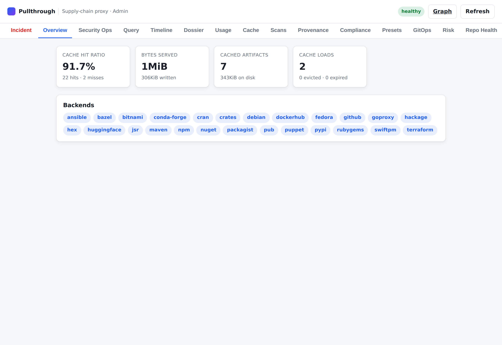

Every view shares the top bar:

- **Health pill** (`healthy`/`degraded`) — live service health, polled from the
  server health endpoint.
- **Graph** — opens the force-directed [supply-chain graph](#the-supply-chain-graph).
- **Refresh** (keyboard `r`) — re-fetches the active view.
- **Sign out / identity pill** — shown when [SSO](admin-sso-rbac.md) is enabled.

Below it is the **tab bar**. Tabs follow the WAI-ARIA tabs pattern (arrow keys
move between them), and the red **Incident** tab is always first so the
kill-switch is one keystroke away during a crisis. An emergency-lockdown banner
(hidden here) appears across every tab when a lockdown is active. The address
bar names the open tab (`…/admin/#secops`), so a tab can be bookmarked or
linked, and survives a reload.

The **Overview** tab itself is the at-a-glance landing page: cache hit ratio,
bytes served, cached-artifact count and load/eviction counters, plus the full
list of configured upstream **backends**.

---

## Overview → Security Ops (the SOC view)

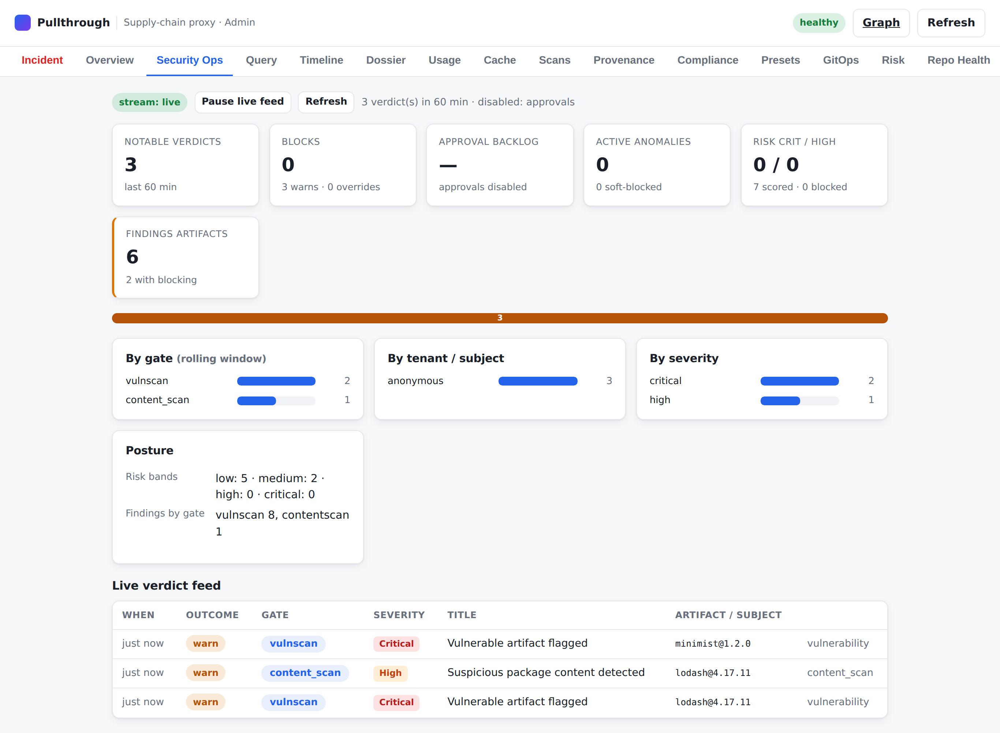

The **Security Ops** tab is the real-time Security Operations Center view
([secops.md](secops.md)). A live **server-sent-events** feed streams notable
verdicts as they happen (`stream: live`), backed by a rolling-window summary:

- Stat tiles — notable verdicts, blocks (warns/overrides), approval backlog,
  active anomalies, critical/high risk counts, findings artifacts.
- Breakdowns **by gate**, **by tenant/subject** and **by severity**.
- A **Posture** card (risk-band distribution + findings per gate).
- The **Live verdict feed** table — here showing the two vulnerable pulls being
  flagged by the `vulnscan` and `content_scan` gates in real time.

Each feed row drills down into the owning subsystem's own tab.

---

## Downloads — which package went to which address

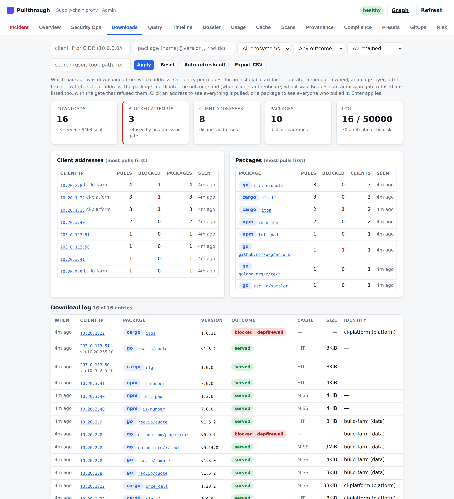

The **Downloads** tab is the [download log](download-log.md): one entry per
package a client pulled through the proxy — and per attempt an admission gate
refused — with the **client address** it came from. It is the tab to open when a
package turns out to be malicious (*who has it?*) or a build host turns out to
be compromised (*what did it pull?*). It is on by default.

- **Filter bar** — client IP or CIDR, package (a name or `name@version`, `*` as a
  wildcard), ecosystem, outcome, time range, and a free-text search over
  address, package, path, client tool, identity and reason.
- **Stat tiles** — downloads and bytes sent, blocked attempts, distinct client
  addresses and packages, and the log's own bounds (entries held / capacity,
  retention, whether it is persisted).
- **Client addresses** and **Packages** — the busiest of each for the current
  filter, with their blocked counts.
- **Download log** — newest first: when, client address, package and version,
  outcome (`served`, `blocked · <gate>`, `not found`, …), cache status, size and
  the authenticated identity.

**Click an address** to see everything it pulled; **click a package** to see
everyone who pulled it. An address shown with a second line (`via 10.20.255.10`)
reached the proxy through a trusted reverse proxy: the address is the client's,
taken from `X-Forwarded-For`, and the second line is the proxy it came through
([`server.trustedProxies`](download-log.md#the-client-address-and-reverse-proxies)).

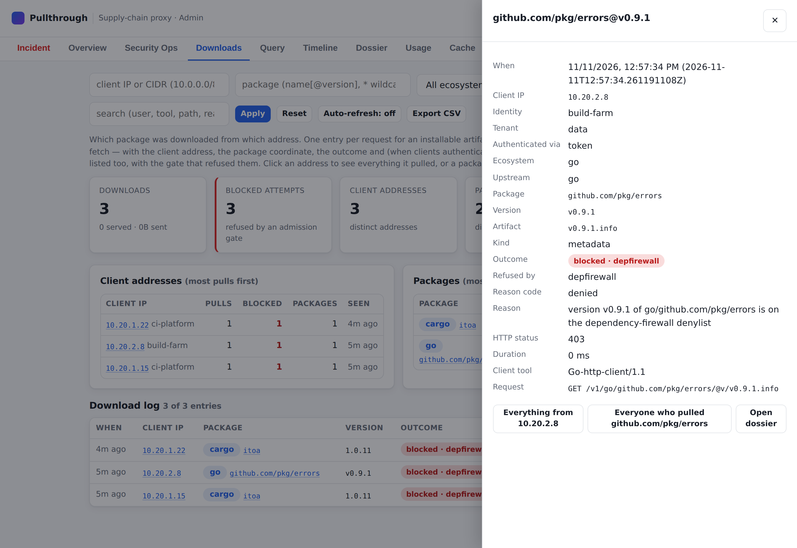

A row opens the detail drawer: every field of the entry — here a Go module the
dependency firewall refused, with the gate, its reason code and its explanation,
the client tool and the identity it authenticated as — and the two pivots as
buttons, plus *Open dossier* for the package. *Export CSV* downloads every
matching entry; the address bar carries the filter
(`…/admin/#downloads?package=cfg-if`), so a view can be linked from a ticket.

This screenshot was captured with clients on a private network pulling real
crates, Go modules and npm packages through the proxy, two of them
authenticating with tokens and two reaching it through a load balancer.

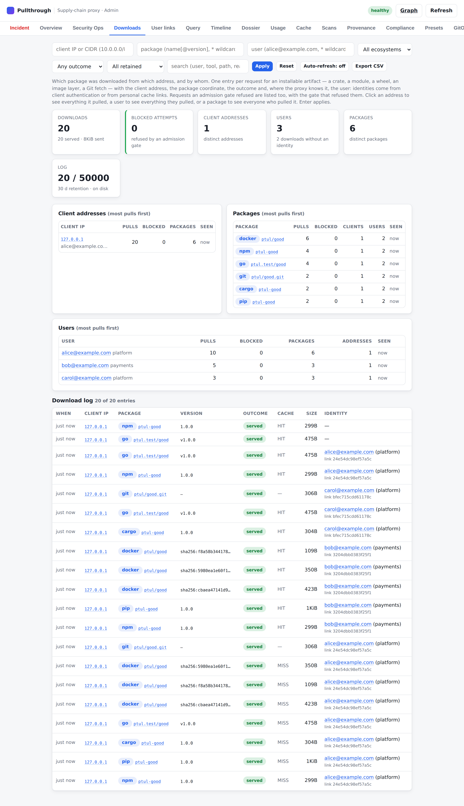

Where the proxy knows **who** a client was — a [personal cache link](user-links.md),
a token — the tab answers by person as well. The filter bar takes a **user** (a
name, a pattern such as `*@example.com`, or `-` for the downloads nobody was
identified for); a **Users** tile counts the identified users and the downloads
without an identity; a **Users** panel lists the busiest users with the number
of addresses each was seen on; and every entry shows its user, team and the
personal link it came through. **Click a user** to see everything they pulled.
In this screenshot every client ran on the same machine: one address, three
people.

---

## User links — who holds a personal cache link

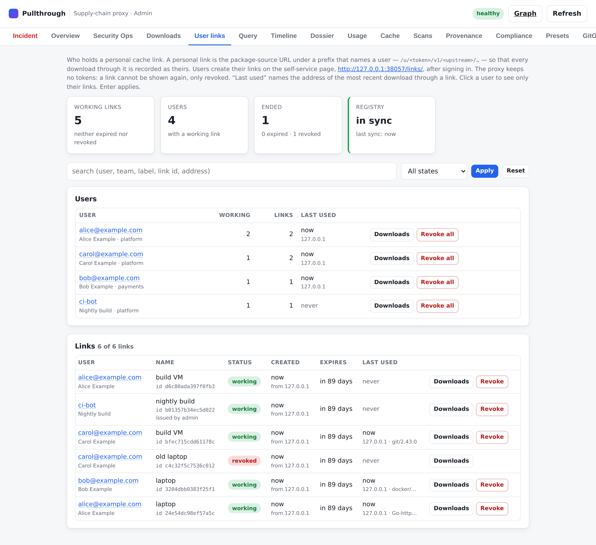

The **User links** tab is the operator's view of [personal cache links](user-links.md):
the per-user addresses of the package sources that cache users create after
signing in through the identity provider, so that their downloads are recorded
under their name.

- **Stat tiles** — working links, users holding one, ended links (expired /
  revoked), and whether the link registry is in sync with its store. When it is
  not, a banner says so: links this replica does not already know are refused
  until it is.
- **Users** — each user with their working and total links and the most recent
  use of any of them; *Downloads* opens the download log filtered to the user,
  *Revoke all* ends everything issued to them — every link, on every replica,
  and their session on the links page.
- **Links** — every link: its user, the name they gave it, its state, when and
  from where it was created, when it expires, and when, from which address and
  with which client tool it was last used. *Revoke* ends one link. A link an
  administrator issued (`ptctl userlinks issue`) says so.

The search box matches user, team, name, link identifier and address; the state
filter narrows to working, expired or revoked links; clicking a user narrows
both lists to them. The tab shows no link itself: the proxy keeps only a hash of
each, so a link can be revoked here but never displayed.

---

## Incident — the global kill-switch

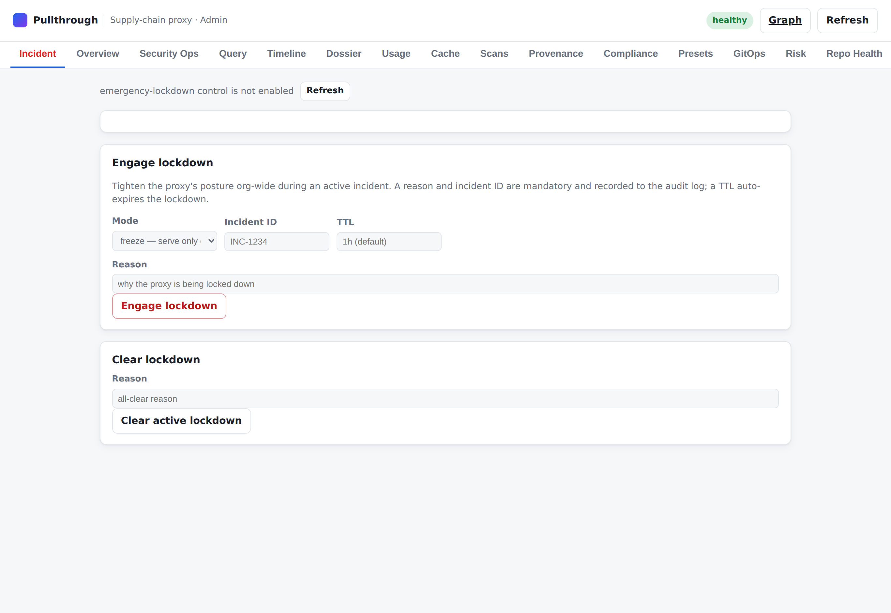

The **Incident** tab drives the emergency lockdown / global kill-switch
([lockdown.md](lockdown.md)). During an active incident an operator can
**Engage lockdown** in `freeze`, `strict` or `block` mode — a reason and
incident ID are mandatory and recorded to the tamper-evident audit log, and an
optional TTL auto-expires the lockdown — then **Clear** it when the all-clear is
given. (Disabled in the example config, hence the notice at the top.)

---

## Query — the federated console

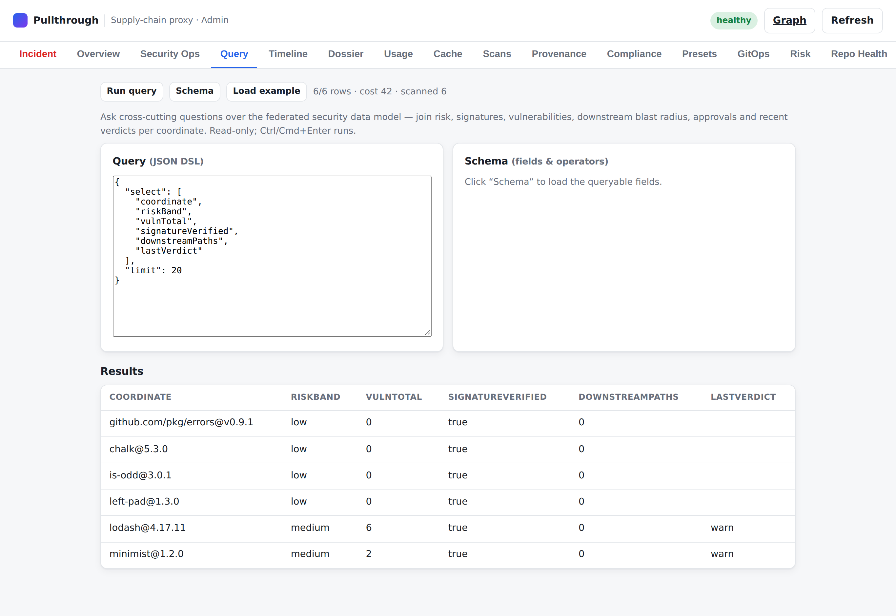

The **Query** tab is a read-only console over the federated security data model
([query-api.md](query-api.md)). Write a small JSON DSL that joins risk,
signatures, vulnerabilities, downstream blast radius, approvals and recent
verdicts **per coordinate**; `Ctrl/Cmd+Enter` runs it. The **Schema** button
lists every queryable field and its operators; **Load example** drops in a
starter query. The toolbar reports rows, query cost and rows scanned.

---

## Dossier — the per-coordinate "360 view"

The **Dossier** tab assembles the complete security story for one artifact
coordinate into a single triage card ([the dossier API](security-model.md)): it
reads live across every wired subsystem and degrades gracefully when one is
disabled. A clean package admits:

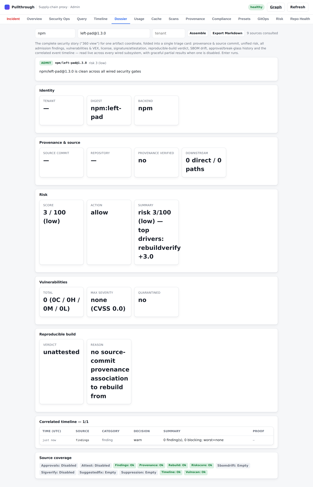

…while a vulnerable one shows exactly *why* it is risky — unified risk score and
its top drivers, the vulnerability roll-up (counts, max CVSS), every admission
finding with its gate and rule, the reproducible-build verdict, the correlated
event timeline, and a source-coverage strip showing which subsystems
contributed:

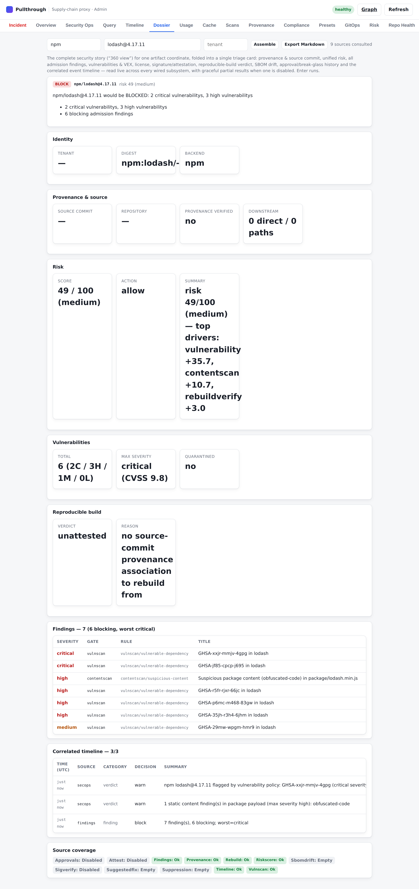

**Export Markdown** produces a shareable triage write-up.

---

## Cache — what's stored

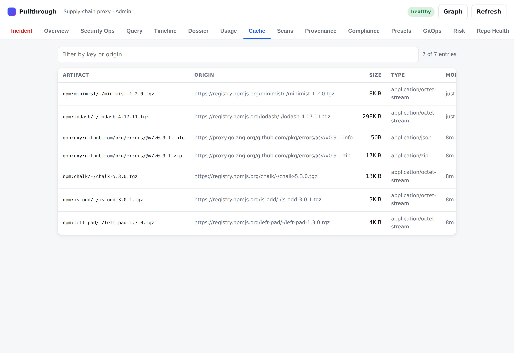

The **Cache** tab lists content-addressable cache entries — the artifact key,
upstream origin, size, content type and age — filterable by key or origin. Each
row opens a detail drawer, and entries can be deleted (an `operate` capability
under [RBAC](admin-sso-rbac.md)).

---

## Scans — Git commit scanning

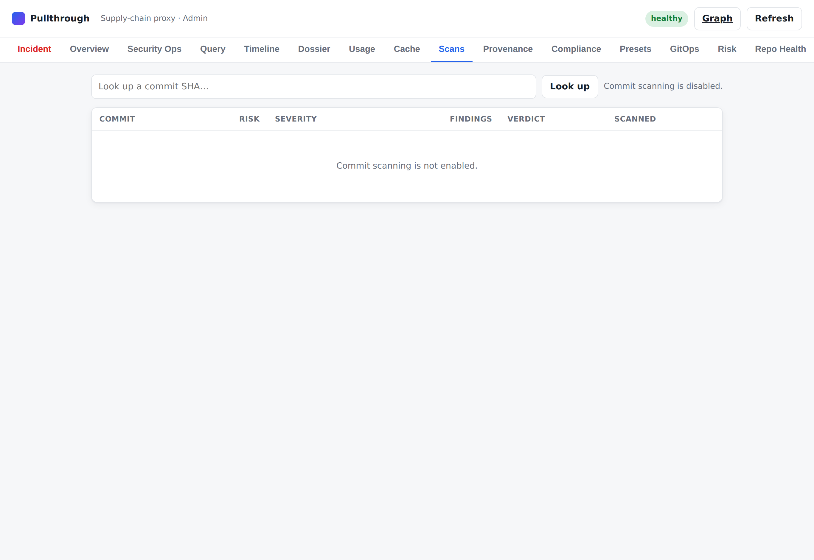

The **Scans** tab surfaces the LLM-based **Git commit scanning** results
([commit-watch.md](commit-watch.md)): look up a commit SHA to see its risk band,
severity, findings and admission verdict. Commit scanning needs an LLM provider
and is off in the example config, so the tab shows its disabled state here.

---

## Provenance — package → source commit

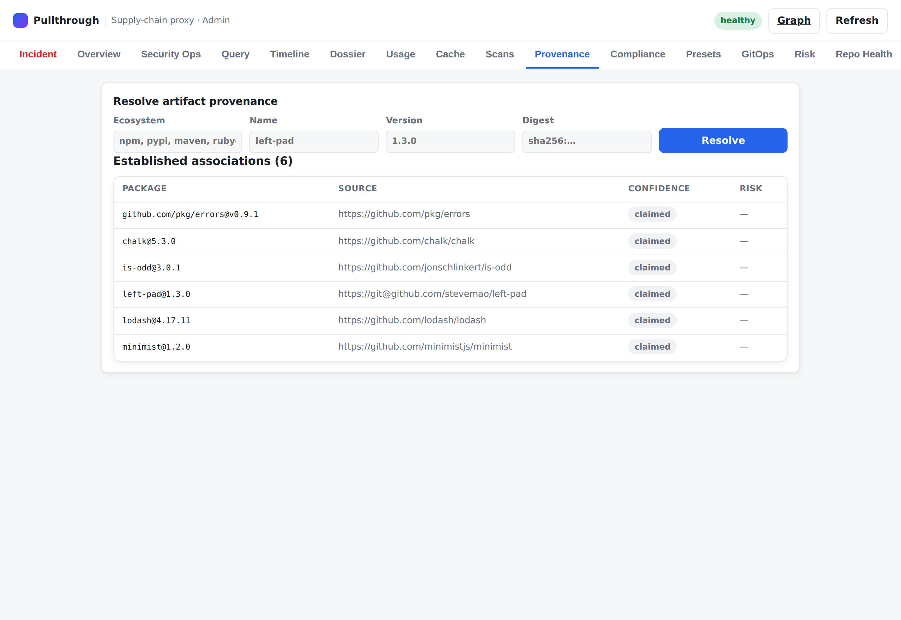

The **Provenance** tab resolves an artifact to its originating source repository
and commit ([build-provenance.md](build-provenance.md)), via GitHub/GitLab/
Bitbucket build-provenance attestations or other association signals. The
**Established associations** table lists the package→source links discovered
from the pulls above, each with a confidence level.

---

## Risk — explainable scoring

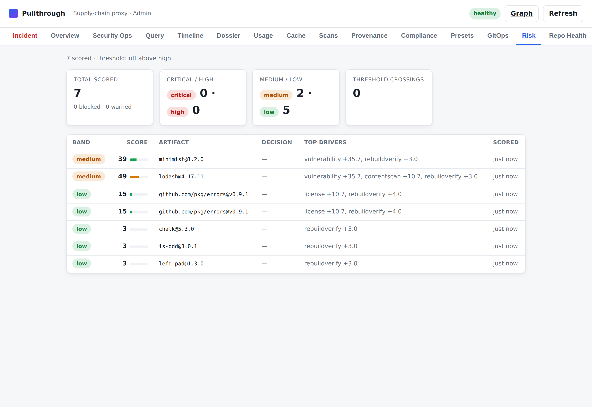

The **Risk** tab shows the unified supply-chain risk score per artifact, banded
`low`/`medium`/`high`/`critical`, with the **top drivers** that explain each
score and the configured threshold/action. The tiles summarise the band
distribution and how many artifacts crossed the enforcement threshold.

---

## Compliance — the scorecard

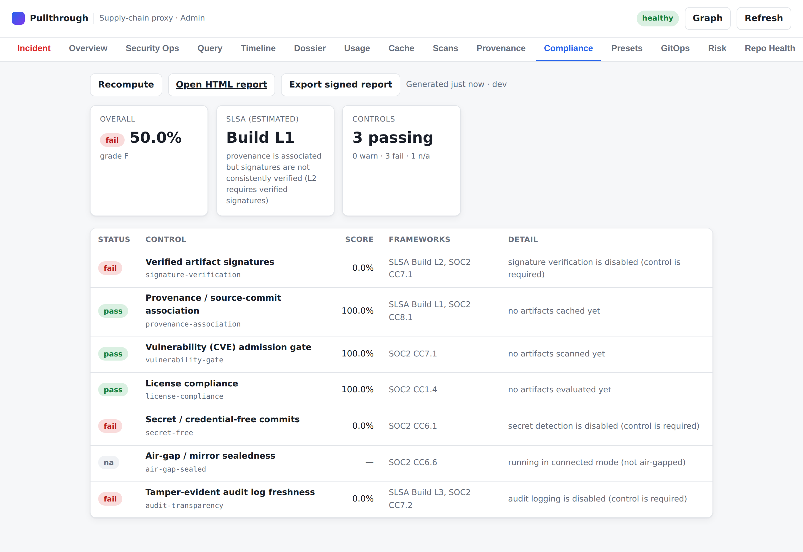

The **Compliance** tab renders the continuous compliance scorecard: an overall
grade, an estimated SLSA build level, and a per-control table mapped to
frameworks (SLSA, SOC2) with pass/fail/na status and a plain-language reason. It
reflects your *enabled posture* — controls for disabled gates read `fail`/`na`.
**Open HTML report** and **Export signed report** produce auditor-ready
artifacts.

---

## Presets — one-click hardening

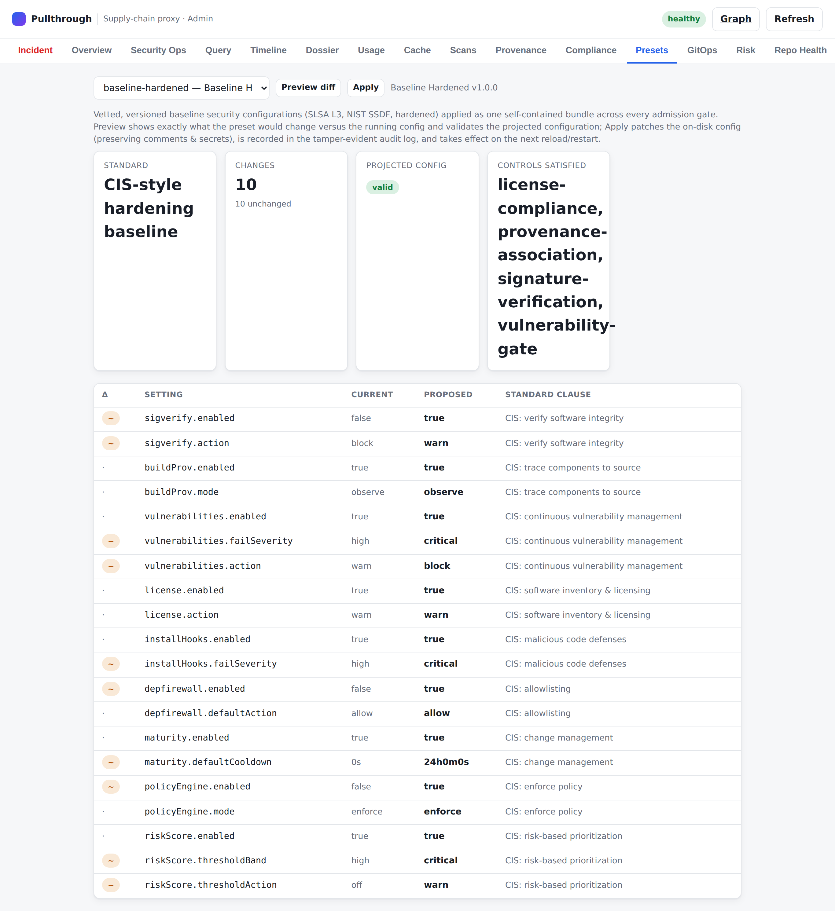

The **Presets** tab applies vetted, versioned baseline configurations (SLSA L3,
NIST SSDF, CIS-style hardening) as one self-contained bundle across every gate
([compliance-presets.md](compliance-presets.md)). **Preview diff** shows exactly
what the preset would change versus the running config — current vs proposed per
setting, with the standard clause each change satisfies — and validates the
projected config before you **Apply** it (which patches the on-disk config,
preserving comments and secrets, and is recorded in the audit log).

---

## Firewall, Egress & Approvals

The remaining operational tabs follow the same pattern — a focused panel over
one subsystem:

| Tab | Screenshot | Purpose |
|-----|------------|---------|
| **Firewall** | 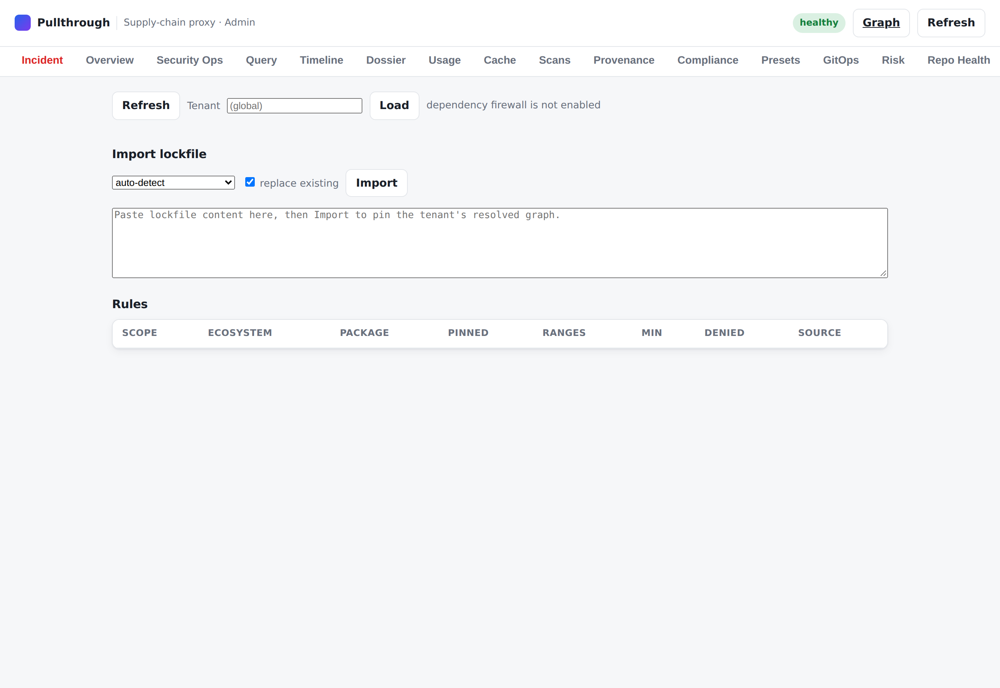 | Version-pinning & allowlist enforcement ([dependency-firewall.md](dependency-firewall.md)) |
| **Egress** | 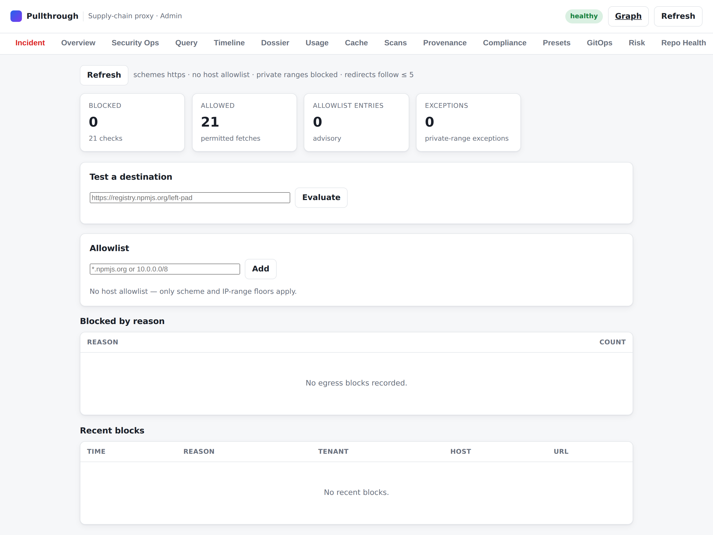 | SSRF / outbound-egress allowlist state ([egress-ssrf.md](egress-ssrf.md)) |
| **Approvals** | 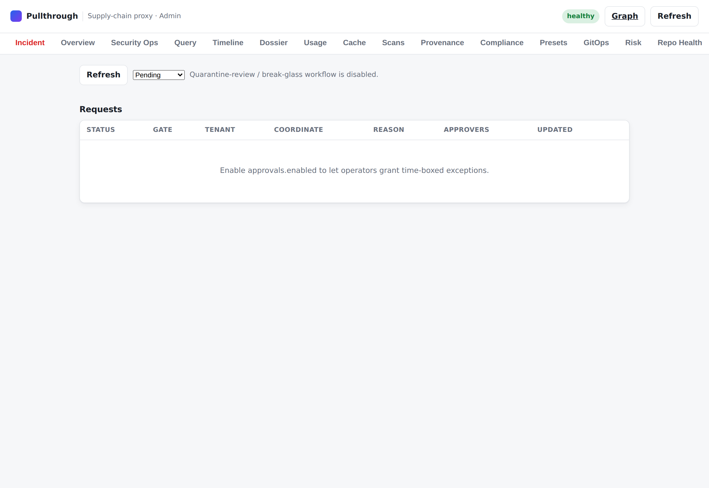 | Quarantine review & break-glass workflow ([approvals.md](approvals.md)) |

Other tabs not pictured here — **Timeline**, **Usage**, **Repo Health**,
**Drift**, **Reproducible Builds**, **Build Provenance**, **Extensions**,
**Anomaly**, **Cooldown**, **Continuity**, **Snapshots**, **Install Hooks**,
**GitOps**, **Passkeys** — expose their respective subsystems the same way; each
has a dedicated deep-dive doc linked from the [docs index](README.md).

---

## Policy — the effective configuration

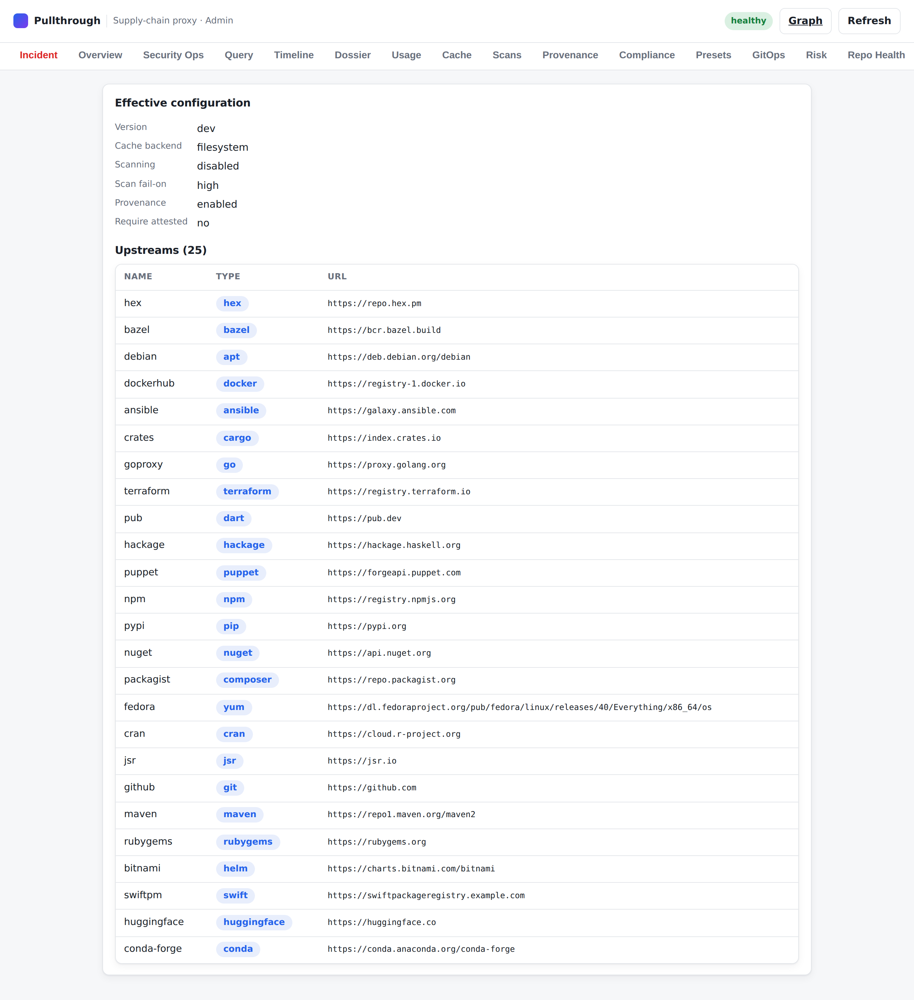

The **Policy** tab is a read-only mirror of the proxy's **effective
configuration**: version, cache backend, scanning/provenance posture, and the
full table of configured **upstreams** with their type and URL. It's the fastest
way to confirm what a running instance is actually enforcing.

---

## The supply-chain graph

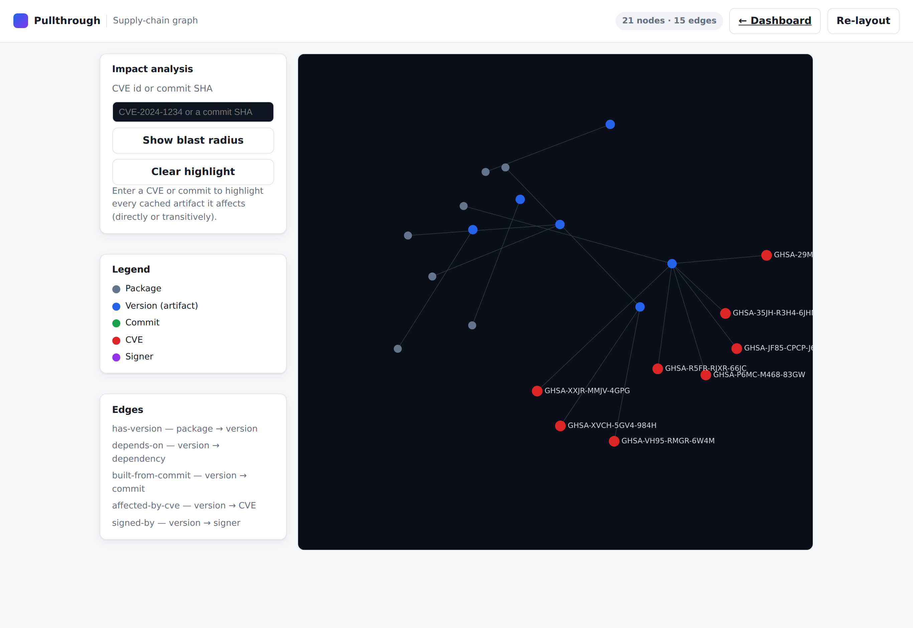

Opened from the top-bar **Graph** link (`{prefix}/graph.html`), the
force-directed graph visualizes the provenance & dependency store
([query-api.md](query-api.md)): packages, versions (artifacts), commits, CVEs
and signers, joined by typed edges. The **Impact analysis** box highlights every
cached artifact a given CVE or commit affects — directly or transitively — the
blast radius of a supply-chain event.

---

## Dark mode

The entire console is theme-aware and meets the WCAG 2.1 AA contrast baseline in
both themes ([accessibility.md](accessibility.md)); it follows your OS setting
automatically.

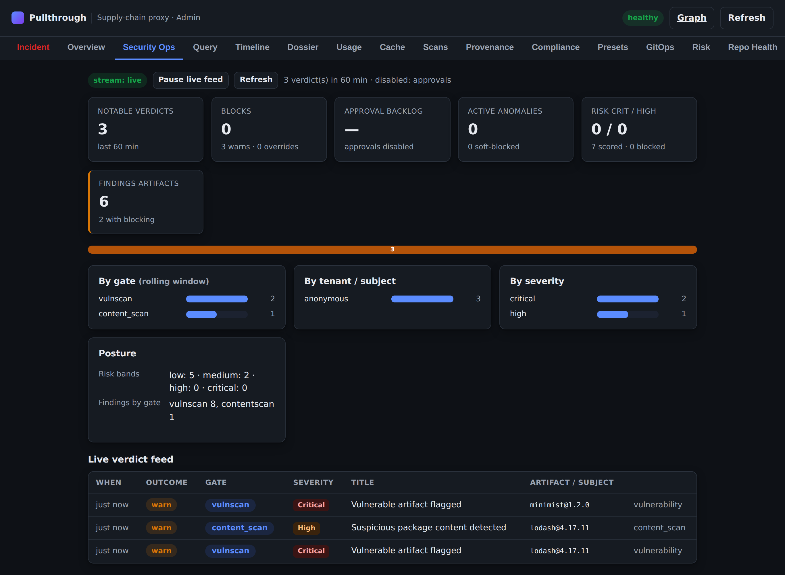

---

## Where next

- Lock the console down: [admin-sso-rbac.md](admin-sso-rbac.md) (SSO + RBAC),
  [webauthn-stepup.md](webauthn-stepup.md) (passkey step-up).
- Drive the same data headless: [query-api.md](query-api.md),
  [grpc-api.md](grpc-api.md), [mcp-server.md](mcp-server.md).
- Operate it: [runbook.md](runbook.md),
  [incident-response-playbook.md](incident-response-playbook.md).
