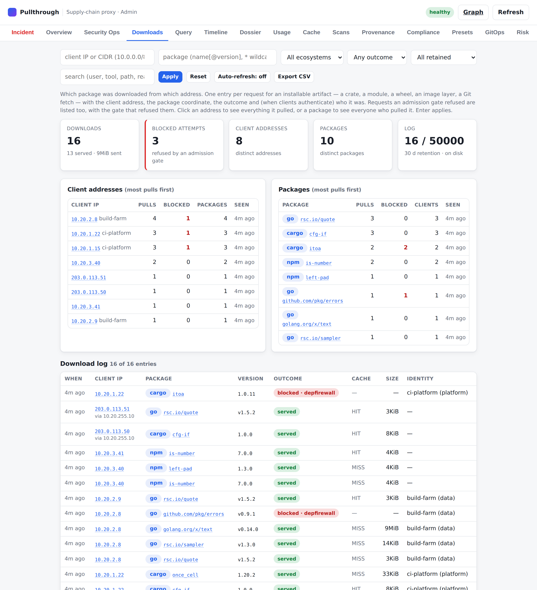

# Download log — which package was downloaded from which address (Task 176)

When a package turns out to be malicious, the first question is *who has it*.
When a build host turns out to be compromised, it is *what did it pull*. The
download log answers both: it records, for every package a client pulls through
the proxy, the **client address** the request came from, the **package
coordinate** it resolved to (ecosystem, name, version), **what happened**
(served, refused by an admission gate, not found, failed) and — when clients
identify themselves — **who** it was. With [personal cache links](user-links.md)
every cache user signs in through the identity provider and downloads through an
address of their own, so the log names a person where an address would name a
NAT gateway.

It is shown in the admin console's **Downloads** tab, served by the admin API,
available on the command line as `ptctl downloads`, and it is **on by default**.



- [What is recorded](#what-is-recorded)
- [The Downloads tab](#the-downloads-tab)
- [Admin API](#admin-api)
- [`ptctl downloads`](#ptctl-downloads)
- [Configuration](#configuration)
- [The client address, and reverse proxies](#the-client-address-and-reverse-proxies)
- [Bounds, retention and privacy](#bounds-retention-and-privacy)
- [Persistence](#persistence)
- [Metrics](#metrics)
- [How it relates to the audit log](#how-it-relates-to-the-audit-log)
- [Tests](#tests)

## What is recorded

One entry per request for **something a client installs**: a crate, a Go module
zip, a wheel or sdist, an npm tarball, an image manifest or layer, a model
weight file, an OS package, a Git fetch.

| Request | Logged? |
|---|---|
| A package artifact, served (`200`, or `206` for a byte range) | yes — `served` |
| A package artifact the client already holds (`304`) | yes — `not_modified` |
| A request an **admission gate refused** — whatever it asked for | yes — `blocked`, with the gate, its reason code and its explanation |
| A package the upstream does not have (`404`/`410`) | yes — `not_found` |
| A package request that failed (upstream error, the client went away — also while a gate was still deciding) | yes — `error` |
| Index documents, version lists, checksum files (metadata) | no — unless `downloadLog.includeMetadata`, or the request was refused |
| A `HEAD` that was answered | no — nothing was transferred |
| A request that never named a resource (unknown upstream, bad path), or was rejected by client authentication | no — that is the [audit log](access-control-and-audit.md)'s |
| A Git ref listing (`ls-remote`, the first half of a clone) | no — only the fetch (see [Git](#git)) |
| The proxy's own [pre-warm](prewarm.md) fetches | no — not a client |
| A sibling proxy reading this cache through [cache federation](cache-federation.md) | no — the sibling logs the download it serves to its client |

Two rules in that table deserve a sentence each:

- **A refused request is always recorded.** A gate that judges a package by its
  coordinate refuses the *first* request that names it. For cargo that is the
  crate download; for the `go` command it is the version's `.info` — a metadata
  request — and the client stops there. The refused metadata request is the only
  trace of the attempt, so it is kept.
- **Bytes count package content only.** `bytes` is what the client received of
  the artifact. The body of a refusal is an explanation, not package content;
  a blocked entry has `bytes: 0`, so "how much of this package went out" has an
  answer.

### Entry fields

| Field | Meaning |
|---|---|
| `id` | Sequence number; also the pagination cursor. It identifies an entry among those the log holds, not for all time: a log whose every entry has expired starts again at 1 |
| `time` | When the request completed (UTC) |
| `clientIp` | The address the download is attributed to — see [below](#the-client-address-and-reverse-proxies) |
| `forwardedBy` | The trusted reverse proxy the connection came from, when `clientIp` was taken from its `X-Forwarded-For` |
| `ecosystem`, `upstream` | The ecosystem (`cargo`, `go`, `npm`, …) and the configured upstream that served it |
| `package`, `version` | The coordinate the request resolved to |
| `artifact`, `digest` | The file name of what was requested, and its expected digest when the protocol states one |
| `kind` | `package`, `metadata` or `unclassified` (a resource the protocol adapter cannot name — it may well be a package, so it is recorded) |
| `outcome` | `served` · `not_modified` · `blocked` · `not_found` · `error` |
| `gate`, `code`, `reason` | For a blocked entry: the admission gate that refused it, its machine reason code, its explanation |
| `status` | The HTTP status the proxy answered with. `499` when the client went away before the answer (or was answered only with the error its own cancellation caused); `0` for Git over SSH |
| `cache` | `MISS` (fetched from upstream for this request), `HIT`, `COALESCED-HIT`, `BYPASS` (never cached) |
| `bytes`, `size` | Bytes of the artifact sent, and the artifact's full size. `bytes < size` is a byte-range request or an abandoned transfer |
| `durationMs` | How long the proxy took, upstream fetch and every gate included |
| `subject`, `tenant`, `authMethod` | The identified client: a user who downloads through a [personal cache link](user-links.md) (`authMethod: personal-link`), or the principal of a token, an OIDC JWT or a client certificate when [client authentication](access-control-and-audit.md) is on |
| `link` | For a download through a personal cache link: the link's identifier — which of the user's links it was, hence which of their machines. Not a secret (it is derived from a hash of the link) |
| `userAgent` | The client tool (`cargo/1.84.0 …`, `Go-http-client/1.1`, `npm/10.9.2 …`) |
| `method`, `path` | The request (no query string: queries can carry credentials) |
| `traceId` | The request's distributed-trace id, when [tracing](tracing.md) is on |

Everything in an entry that a client or an upstream chose — names, paths, the
User-Agent — is length-bounded and stripped of control characters before it is
stored, and it is stored as a copy: an entry never keeps the request it was cut
from in memory. Invisible format characters (a right-to-left override, a
zero-width space) are written out — `left\u{200B}-pad` — so that a name cannot
be made to *look* like another one in a record people read to decide what was
downloaded.

### Git

A clone or fetch is, for "who has this code", the same as a package download.
Over HTTP both a ref listing and a fetch are a `POST` to `git-upload-pack`; only
the request body tells them apart. The log is what an operator reads to learn
who fetched a repository, so the question is asked the cautious way round:

- an `upload-pack` request is **left out only when its body shows it to be a
  ref listing** (protocol v2 `ls-refs`; also `object-info` and `bundle-uri`,
  which hand out no objects) or to ask for nothing at all;
- **every other one is recorded** — a fetch in protocol v0/v1 or v2, compressed
  or not, however it is phrased, and equally a request the proxy cannot read: an
  encoding it does not know, a body that is not what the protocol describes, a
  command behind more preamble than is examined. The server may reject such a
  request; the entry then says so (`error`, with the status).

The body is read the way Git's own server reads it (the command may come after
capability lines, one line feed is stripped, the command name is compared
exactly, a second command voids the request), so that a fetch cannot be phrased
to look like a listing. The integration tests hold that against the real thing:
unusual phrasings of a fetch — the command after a capability line, a `deepen`
before the first `want`, gzip streams that hide their content behind a long
header or thousands of empty blocks — are fed to the real `git upload-pack` and
`git http-backend`, and every one that is answered with a pack must be recorded.

The entry's `package` is the repository; a fetch names no version. Git LFS
objects are logged with their object ID as `artifact` and `digest`; one that a
gate refuses is `blocked` like any other download, by `llmpkgscan` (the package
scan) or `lfs-content` (`git.lfs.blockOnFindings`). Over **SSH** the entry has
`method: SSH`, the client's address is the TCP peer, and `subject` is the
SHA-256 fingerprint of the key the client authenticated with.

## The Downloads tab

`{admin prefix}/#downloads`. The tab is a filter over the log:

- **Filter bar** — client IP or CIDR, user (a name, a pattern such as
  `*@example.com`, or `-` for downloads nobody was identified for), package (a
  name or `name@version`, `*` as a wildcard), ecosystem, outcome, time range,
  and a free-text search over address, package, path, client tool, identity and
  reason. Enter applies.
- **Cards** — downloads, blocked attempts, distinct client addresses, distinct
  users (and how many downloads have none), distinct packages, and the log's own
  bounds (`held / capacity`, retention, whether it is on disk).
- **Client addresses**, **Users** and **Packages** — the busiest of each for
  the current filter. They are the questions in table form. The Users panel
  appears once the log holds a download with an identity.
- **Download log** — the entries, newest first, 100 at a time (*Load older
  entries*).

**Click an address** anywhere to see everything it pulled; **click a user** to
see everything they pulled, from whichever address; **click a package** to see
everyone who pulled it. A row opens the detail drawer with every field
and the same two pivots, plus *Open dossier* for the package's
[security dossier](admin-ui-walkthrough.md#dossier--the-per-coordinate-360-view).

*Auto-refresh* reloads the view every five seconds; *Export CSV* downloads every
matching entry.

The address bar follows the filter — `…/admin/#downloads?package=left-pad` — so
"who pulled left-pad" is a link you can paste into a ticket.

## Admin API

Both endpoints are `GET`, read-only, and require the admin credential
(`observability.adminToken`) or, under [SSO/RBAC](admin-sso-rbac.md), the `read`
capability (role `viewer` and up).

### `GET {prefix}/api/downloads`

Entries, newest first. All parameters are optional and ANDed:

| Parameter | Meaning |
|---|---|
| `ip` | Client address (`10.0.0.7`, `2001:db8::1`) or CIDR prefix (`10.0.0.0/8`) |
| `package` | The package, ignoring case: its name (`left-pad`, `@acme/widgets`) or its `name@version` coordinate (`left-pad@1.3.0`). `*` matches any run of characters (`@acme/*`, `*crypto*`, `left-pad@1.*`); without one the match is exact. Both readings are tried, because a name can contain an `@` itself — Homebrew's `openssl@3` is a package, not version 3 of `openssl` |
| `version` | Exact version, for callers that keep name and version apart |
| `ecosystem`, `upstream` | Exact, ignoring case |
| `outcome` | `served` · `not_modified` · `blocked` · `not_found` · `error` |
| `kind` | `package` · `metadata` · `unclassified` |
| `subject` | The identified client. Exact, ignoring case — or a pattern with `*` (`*@example.com`). `-` selects the downloads **nobody was identified for** |
| `tenant` | The client's team, exact |
| `link` | A [personal cache link](user-links.md), by its identifier |
| `q` | Free-text search across the textual fields |
| `since`, `until` | Time bounds: an age (`15m`, `24h`, `7d`), RFC 3339, or unix seconds |
| `limit` | Page size (default 100, at most 1000) |
| `before` | Pagination cursor: the previous response's `nextBefore` |
| `format` | `json` (default) or `csv` |

A value that cannot be parsed is a `400`, never an ignored filter: showing every
download as "from this address" because the address had a typo would be worse
than an error.

```console
$ curl -s -H "Authorization: Bearer $ADMIN_TOKEN" \
    'https://proxy.example.com/admin/api/downloads?package=cfg-if&limit=2'
{
  "enabled": true,
  "total": 2,
  "returned": 2,
  "entries": [
    {
      "id": 2,
      "time": "2026-03-01T12:00:04.1Z",
      "clientIp": "10.20.1.22",
      "ecosystem": "cargo",
      "upstream": "cargo",
      "package": "cfg-if",
      "version": "1.0.0",
      "artifact": "cfg-if-1.0.0.crate",
      "kind": "package",
      "method": "GET",
      "path": "/v1/cargo/api/v1/crates/cfg-if/1.0.0/download",
      "status": 200,
      "outcome": "served",
      "cache": "HIT",
      "bytes": 7934,
      "size": 7934,
      "durationMs": 1,
      "userAgent": "cargo/1.84.0 (66221abde 2024-11-19)"
    },
    { "id": 1, "clientIp": "10.20.1.15", "cache": "MISS", "…": "…" }
  ],
  "log": { "enabled": true, "capacity": 50000, "retained": 2, "retentionSeconds": 2592000, "persistent": true, "…": "…" }
}
```

`total` counts every match; when there are more than the page holds, the
response carries `nextBefore` — repeat the request with `before=<nextBefore>`.
`log` describes the log itself, so a consumer can tell how far back
"everything" reaches. With the log switched off the endpoint still answers:
`{"enabled": false, "total": 0, "entries": []}`.

`format=csv` returns every matching entry as a download — or exactly the first
`limit`, when given: the page-size cap does not apply to an export, which has no
cursor to fetch the rest with. The total is in the `X-Total-Count` header. The
`link` column is the last one, so that a consumer written before it existed
finds every other column where it was. Cells
a spreadsheet would interpret as a formula — a package name starting with `=` is
a thing an attacker can publish — are prefixed with an apostrophe.

### `GET {prefix}/api/downloads/summary`

The aggregates for the same filters (paging parameters are ignored), plus `top`
— how many clients and packages to list (default 10, at most 500):

```console
$ curl -s -H "Authorization: Bearer $ADMIN_TOKEN" \
    'https://proxy.example.com/admin/api/downloads/summary?package=cfg-if'
{
  "enabled": true,
  "total": 2, "served": 2, "blocked": 0, "notModified": 0, "notFound": 0, "errors": 0,
  "bytes": 15868, "clients": 2, "packages": 1, "users": 2, "unattributed": 0,
  "byClient": [
    { "clientIp": "10.20.1.22", "downloads": 1, "served": 1, "blocked": 0, "packages": 1, "bytes": 7934, "firstSeen": "…", "lastSeen": "…" },
    { "clientIp": "10.20.1.15", "downloads": 1, "served": 1, "blocked": 0, "packages": 1, "bytes": 7934, "firstSeen": "…", "lastSeen": "…" }
  ],
  "byUser": [
    { "subject": "alice@example.com", "tenant": "platform", "downloads": 1, "served": 1, "blocked": 0, "packages": 1, "addresses": 1, "clientIps": ["10.20.1.22"], "links": ["273d43ccab040774"], "bytes": 7934, "firstSeen": "…", "lastSeen": "…" },
    { "subject": "bob@example.com", "tenant": "payments", "downloads": 1, "served": 1, "blocked": 0, "packages": 1, "addresses": 1, "clientIps": ["10.20.1.15"], "links": ["e8e4db1dc8b278b9"], "bytes": 7934, "firstSeen": "…", "lastSeen": "…" }
  ],
  "byPackage": [
    { "ecosystem": "cargo", "package": "cfg-if", "downloads": 2, "served": 2, "blocked": 0, "clients": 2, "users": 2, "versions": ["1.0.0"], "bytes": 15868, "lastSeen": "…" }
  ],
  "byEcosystem": [ { "ecosystem": "cargo", "downloads": 2, "served": 2, "blocked": 0, "bytes": 15868 } ]
}
```

- `?package=left-pad` → `byClient` is **which addresses pulled left-pad**, and
  `byUser` **who** did.
- `?ip=10.0.0.7` → `byPackage` is **what 10.0.0.7 pulled**.
- `?subject=alice@example.com` → `byPackage` is **what alice pulled**, and
  `byClient` from which machines.
- `users` counts the distinct identified clients among the matches,
  `unattributed` the downloads that have none; `byUser` (at most `top`) is empty
  when no match has an identity.
- `?outcome=blocked&since=24h` → who was refused what in the last day.

## `ptctl downloads`

```console
$ ptctl downloads --package cfg-if                 # who pulled cfg-if?
$ ptctl downloads --ip 10.20.1.15                  # what did 10.20.1.15 pull?
$ ptctl downloads --user alice@example.com         # what did alice pull?
$ ptctl downloads --user - --summary               # what was pulled by nobody known?
$ ptctl downloads --ip 10.20.0.0/16 --outcome blocked --since 24h
$ ptctl downloads --summary --ecosystem cargo      # busiest addresses and crates
$ ptctl downloads --all --format csv > downloads.csv
```

Flags mirror the API (`--ip`, `--package` — a name or `name@version` —, `--ecosystem`,
`--upstream`, `--outcome`, `--user` (also `--subject`), `--link`, `--search`,
`--since`, `--until`), plus `--limit` (default 50), `--all` (page through
everything), `--summary` with `--top` — totals and the busiest addresses, users
and packages —, and `--format table|json|csv`. `--tenant` narrows the log only
when given on the command line — an exported `PULLTHROUGH_TENANT` does not
silently hide other tenants' downloads. See [client-cli.md](client-cli.md).

## Configuration

```yaml
downloadLog:
  enabled: true           # default: on
  maxEntries: 50000       # default; the log is a ring — when full, the oldest entry goes
  retention: 720h         # default (30 days); "0s" = no time limit, only maxEntries
  path: /var/lib/pullthrough/downloads.jsonl   # default: unset → in memory only
  includeMetadata: false  # default; true also records index / version-list requests

server:
  # Reverse proxies whose X-Forwarded-For is believed. Default: none.
  trustedProxies: ["10.0.0.0/8", "192.168.1.10", "fd00::/8"]
```

| Setting | Default | Notes |
|---|---|---|
| `downloadLog.enabled` | `true` | Off: nothing is recorded; the API answers `enabled: false`; the tab says so |
| `downloadLog.maxEntries` | `50000` | Up to 5 000 000. An entry typically costs under a kilobyte of memory, and never more than a few: every field is length-bounded |
| `downloadLog.retention` | `720h` | Applies in memory **and on disk**. `0s` disables time-based expiry |
| `downloadLog.path` | — | JSON Lines, mode `0600`. The proxy refuses to start when it cannot append to the file **or cannot create files next to it** (the log is kept within its bounds by replacing the file through a temporary one) |
| `downloadLog.includeMetadata` | `false` | Metadata requests outnumber downloads many times over |
| `server.trustedProxies` | `[]` | IP addresses and CIDR prefixes; see the next section |

## The client address, and reverse proxies

By default `clientIp` is the **TCP peer**: the address the connection came from.
`X-Forwarded-For` is a header the sender writes, so by default it is **never
read** — a client connecting directly cannot attribute its downloads to another
machine.

Behind a load balancer or an ingress controller the TCP peer is the balancer,
for every request. List the balancers in `server.trustedProxies`; for a request
arriving **from one of them**, the client address is taken from the
`X-Forwarded-For` header instead:

- the header is read **from the right**: each trusted hop appends the address it
  received the request from, so the right-most entry that is not itself a
  trusted proxy is the nearest address a trusted party vouches for. Whatever
  lies to its left is the client's own claim and is ignored;
- the entry's `forwardedBy` names the proxy the connection came through;
- a request from any other peer has its header ignored, exactly as with the
  list empty.

```
client 203.0.113.50 ──► balancer 10.255.0.10 ──► proxy
   sends  X-Forwarded-For: 10.1.1.1            (forged)
   becomes X-Forwarded-For: 10.1.1.1, 203.0.113.50
   logged: clientIp 203.0.113.50, forwardedBy 10.255.0.10
```

List only infrastructure that appends to (or overwrites) the header itself;
**never a network clients are on**. `pullthrough verify-config` warns about an
entry that trusts every address (`0.0.0.0/0`, `::/0`).

The same resolved address is what the [audit log](access-control-and-audit.md)
records as `remoteAddr` and what anomaly detection scopes anonymous traffic by —
there is one definition of "the client" per request.

In [TLS-interception mode](intercept-mode.md) the client connects to the proxy
directly, so the TCP peer is the client. Git over SSH has no forwarding header;
its address is always the TCP peer.

## Bounds, retention and privacy

The log is a ring: at most `maxEntries` entries, the oldest dropped first, and
nothing older than `retention`. Both bounds hold in memory and on disk, so
neither grows with traffic.

Client addresses — and the identities next to them — are personal data in most
jurisdictions. Three properties are there for that reason:

- **retention is enforced on disk too**: an expired entry is removed from the
  file within the hour, without waiting for a restart or for the file to fill;
- **the file is private** (`0600`, in a `0700` directory when the proxy creates
  it). A file that already exists with wider permissions — restored from a
  backup, laid down by a deployment script — is made private when it is opened;
- **the log is behind the admin credential**, like every other admin endpoint,
  and read-only: there is no API that edits or deletes entries.

### What the log is not

It is an operator's index, not evidence that cannot be displaced. A ring keeps
the newest entries, so **a client can push older entries out by making many
requests** — and cheap ones do: cache hits, requests a gate refuses. Nothing in
the log distinguishes a flood from traffic, except that the flood is there to be
seen (thousands of entries from one address) and that
`pullthrough_downloadlog_evicted_total` climbs while `…_expired_total` stays
flat. What bounds it is [rate limiting](configuration.md#ratelimit) in front of
the log and `maxEntries` behind it.

For a history that is longer, tamper-evident or cannot be displaced, forward the
audit log to a SIEM ([siem.md](siem.md)): its pull records carry the same
address and — since this task — the package coordinate.

## Persistence

With `downloadLog.path` set the log survives a restart. Recording a download
only touches memory and never waits for the disk; a background flush appends
what is new to the file about once a second and on shutdown, and the file is
rewritten in place (temporary file, then rename) when it holds noticeably more
than the log retains or holds expired entries.

On start the proxy reloads the entries that are still within the bounds. What a
crash, a full disk or an editor left in the file does not keep the proxy from
starting: unreadable lines — a line cut short, a last line without its line
feed — are skipped or repaired, an entry dated in the future is dated now (it
would otherwise never expire), and entry IDs that do not increase are
renumbered. The entry sequence continues where the previous run stopped, for as
long as the file holds an entry.

When the file cannot be written — a full disk — the entries stay in memory and
are served from there; the write is retried after a pause that grows from a
second to a minute, and `pullthrough_downloadlog_persist_errors_total` counts
the attempts. Entries that leave the log before they could be written are
counted in `…_persist_lost_total`.

The format is one JSON object per line, the same shape the API returns:

```json
{"id":1,"time":"2026-03-01T12:00:00Z","clientIp":"10.0.0.5","ecosystem":"cargo","upstream":"cargo","package":"cfg-if","version":"1.0.0","artifact":"cfg-if-1.0.0.crate","kind":"package","method":"GET","path":"/v1/cargo/api/v1/crates/cfg-if/1.0.0/download","status":200,"outcome":"served","cache":"MISS","bytes":7934,"size":7934,"durationMs":12,"userAgent":"cargo/1.84.0"}
```

**Multiple replicas.** Each proxy instance logs the downloads *it* served and
needs its own file; the console and API of an instance show that instance's
log. For a fleet-wide view, forward the audit log to a SIEM, or query each
replica.

**Backups.** The file is *not* part of a [`pullthrough backup`](backup-restore.md)
snapshot. A snapshot verifies that no metadata file changed while it was taken,
and this file changes within a second of every download — as a backup source it
would fail every backup taken while the proxy serves traffic. To keep the log,
copy the file with whatever copies your other state (`cp`, a volume snapshot):
a copy taken at any moment is loadable, because the file is only ever appended
to or replaced as a whole, and a last line the copy cut short is skipped on
load. Put it back at `downloadLog.path` before the proxy starts; entries older
than the retention are dropped when it is loaded.

## Metrics

| Metric | Meaning |
|---|---|
| `pullthrough_downloadlog_entries_total{outcome}` | Downloads recorded, by outcome |
| `pullthrough_downloadlog_retained_entries` | Entries the log holds now |
| `pullthrough_downloadlog_capacity_entries` | `downloadLog.maxEntries` |
| `pullthrough_downloadlog_evicted_total` | Entries dropped because the log was full |
| `pullthrough_downloadlog_expired_total` | Entries dropped because they outlived the retention |
| `pullthrough_downloadlog_persisted_total` | Entries written to the on-disk log |
| `pullthrough_downloadlog_persist_errors_total` | Failed attempts to write the on-disk log |
| `pullthrough_downloadlog_persist_lost_total` | Entries that left the log before they could be written |

`evicted_total` climbing while `expired_total` stays flat means the log is too
small to cover its retention: raise `maxEntries`. A non-zero
`persist_errors_total` means the file cannot be written (the entries are still
served from memory and the write is retried).

## How it relates to the audit log

| | Download log | [Audit log](access-control-and-audit.md) |
|---|---|---|
| Purpose | "who pulled what" — an operator's index | a tamper-evident record of every decision |
| Scope | package downloads and refused attempts | every request, authentication and policy decision |
| Shape | bounded ring, queryable, filterable | append-only hash chain with Merkle proofs |
| On by default | yes | no |
| Where | Downloads tab, `/api/downloads`, `ptctl downloads` | file / SIEM, [Timeline](timeline.md) |

They agree on the client address (both use the address resolved from
`server.trustedProxies`), and an audit `pull` record now names the `package` and
`version` it was for.

## Tests

Besides unit tests of the log, the gateway hook and the admin API, two
integration suites exercise the feature end to end with the **Rust and Go
ecosystems**:

- **Hermetic** — [`internal/e2e/downloadlog`](../internal/e2e/downloadlog/doc.go)
  (`go test -tags integration ./internal/e2e/downloadlog/`). The real
  `pullthrough` binary in front of stub registries (a crates.io sparse index, a
  GOPROXY), driven by the **real `cargo` and the real `go` command**. Every
  client machine reaches the proxy from its own source address; one sits behind
  a trusted proxy, one forges `X-Forwarded-For`. It asserts, through the admin
  API: the logged package / version / address / size, cache hit for the second
  machine, the "who pulled" and "what pulled" filters, CIDR filters, the refused
  attempt with its gate, forwarded and forged addresses, the CSV export, the
  admin credential, the metrics, and persistence across a restart. It writes
  `download-log-matrix.md`.
- **Real registries** — the `download-log` check of the
  [ecosystem test suite](ecosystem-tests.md) (`make test-ecosystems
  ECOSYSTEMS="cargo go"`). The real `cargo` and `go` in their official
  containers pull from crates.io and proxy.golang.org through the proxy, each
  client run from its own address; the log must show the installed package as
  served to both installing machines and the package whose source commit the
  LLM flagged as blocked for the machine that tried.

Both run in CI on every push.

Attribution to a **user** has a suite of its own — two users, one machine, the
real `npm`, `pip`, `cargo`, `go`, Docker Engine and `git` through personal
cache links: [user-links.md](user-links.md#tests).

What a client or a damaged file can put in front of the log is fuzzed
([testing.md](testing.md#fuzzing-the-protocol--manifest-parsers)): the `X-Forwarded-For` resolution (a forged
prefix must never move the client address), the strings an entry stores, the
filter parameters, the CSV export, the on-disk file, and the Git request
classification — which a differential test also holds against the real `git
upload-pack` and `git http-backend`
(`go test -tags integration ./internal/git/`).
