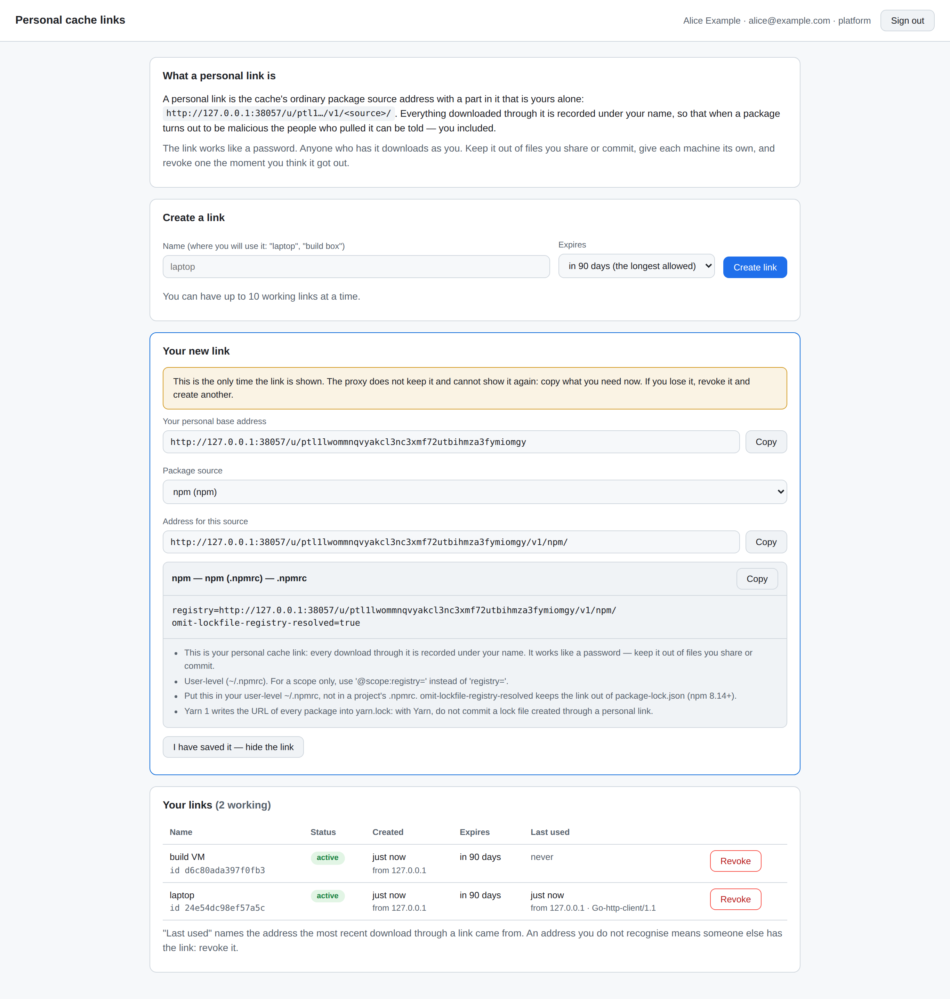
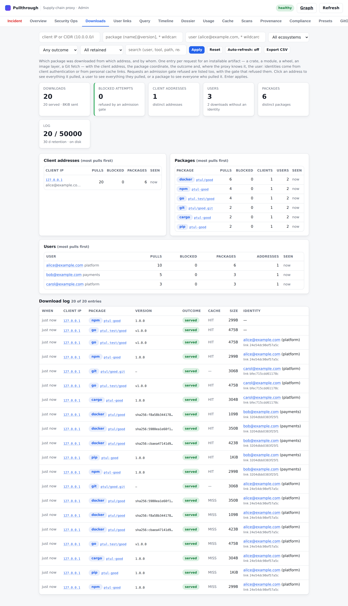
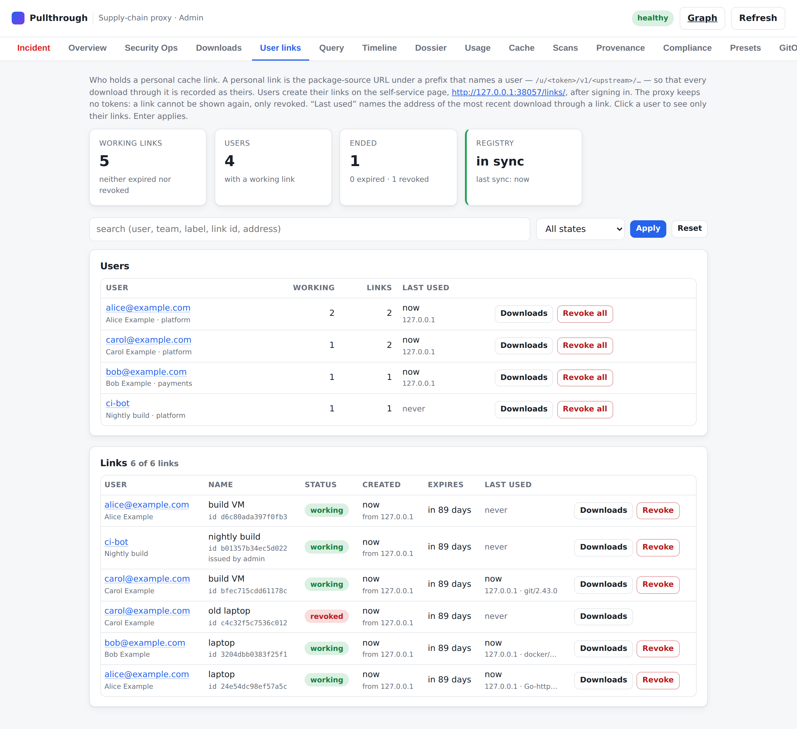

# Personal cache links — downloads tracked per user (Task 177)

The [download log](download-log.md) answers *which package was downloaded from
which address*. An address is a machine — or a NAT gateway, a VPN concentrator,
a shared build host, a laptop that had another address yesterday. When a
package turns out to be malicious, "10.20.0.1 pulled it" starts a search;
"alice@example.com pulled it, on her laptop, on Tuesday" ends one.

Personal cache links add the person. A cache user **signs in through your
OpenID Connect identity provider**, and the proxy hands them **their own
address for every package source** — the ordinary one behind a path prefix that
names them:

```text
https://proxy.example.com/v1/npm/                          the mount
https://proxy.example.com/u/ptl1lwo…mgy/v1/npm/            alice's personal address of it
```

Every download through that address is recorded under the user's name, in the
download log, the audit trail and the metrics. Nothing else changes: the same
cache, the same admission gates, the same upstreams.

- [What a user does](#what-a-user-does)
- [Quick start](#quick-start)
- [What a personal link is](#what-a-personal-link-is)
- [From ID token to user](#from-id-token-to-user)
- [What the download log shows](#what-the-download-log-shows)
- [Managing links](#managing-links)
- [With client authentication on](#with-client-authentication-on)
- [Clients](#clients)
- [How it works](#how-it-works)
- [Several replicas](#several-replicas)
- [Security](#security)
- [Configuration](#configuration)
- [Metrics and audit events](#metrics-and-audit-events)
- [Tests](#tests)
- [What it is not](#what-it-is-not)

## What a user does

1. Opens `https://proxy.example.com/links/` and presses **Sign in**. The browser
   goes to the identity provider and comes back.
2. Presses **Create link**, optionally naming it after the machine it is for
   ("laptop", "build VM").
3. Copies the configuration for their package manager from the page — it is
   generated for the link just created — into the place the page names:

   ```ini
   ; ~/.npmrc
   registry=https://proxy.example.com/u/ptl1lwo…mgy/v1/npm/
   omit-lockfile-registry-resolved=true
   ```

That is all. `npm install` now goes through the user's personal address, and
the proxy knows whose download it is.



The page shows the link **once**. The proxy keeps only a hash of it, so a link
can be revoked but never shown again; a user who lost theirs creates a new one.
The page lists the user's links with when, from which address and with which
tool each was last used — which is how a user notices a link being used by
someone else — and lets them revoke each.

## Quick start

```yaml
server:
  publicUrl: https://proxy.example.com     # personal links are built from it

userLinks:
  enabled: true
  sessionKey: ${USERLINKS_SESSION_KEY}      # ≥ 32 bytes; the same on every replica
  oidc:
    enabled: true
    issuer: https://login.example.com/realms/corp
    clientId: pullthrough-cache
    clientSecret: ${USERLINKS_OIDC_SECRET}  # omit for a public client (PKCE only)
```

At the identity provider, register an OAuth 2.0 client with the redirect URI
`https://proxy.example.com/links/callback` and the scopes `openid profile
email`. Generate the session key with `openssl rand -base64 48`.

That configuration:

- serves the self-service page at `/links/`;
- serves every upstream additionally under `/u/<link>/v1/<upstream>/…`;
- keeps the link registry next to the cache (`<cache.dir>/userlinks`, or in the
  cache's S3 bucket — see [Several replicas](#several-replicas));
- lets links work for 90 days and gives every user up to 10 of them.

`ptctl doctor --config <file>` validates the section offline, and warns about the choices
that deserve a second look: a registry kept in memory or in a directory that
replicas would not share, a plain-HTTP public URL, links that never expire, and
client authentication switched on while signed-in users are given no role.

Without an identity provider (`oidc.enabled: false`) the path prefix still
works, and links are issued by an administrator — see
[`ptctl userlinks issue`](#on-the-command-line).

## What a personal link is

A link is the proxy's public URL, the path prefix (`/u` by default) and a
**token**:

```text
https://proxy.example.com/u/ptl1lwommnqvyakcl3nc3xmf72utbihmza3fymiomgy
└── server.publicUrl ───┘ │ └─────────────── the token ───────────────┘
                userLinks.pathPrefix
```

The token is `ptl1` followed by 39 characters of lower-case base32 (`a`–`z`,
`2`–`7`): 160 random bits and a checksum. The alphabet is what lets it stand
anywhere a client puts a URL path — including a container image name, which
allows nothing else. The checksum lets the proxy tell a link that was cut short
in a copy-paste from one that was never issued, without looking anything up;
and the fixed prefix gives secret scanners a pattern: `ptl1[a-z2-7]{39}`. (The
token in the examples of this documentation matches the pattern and fails the
checksum: it is no one's link.)

There are three ways to present it. All three identify the same user.

| Form | Looks like | For |
|---|---|---|
| **Path prefix** | `https://proxy.example.com/u/<token>/v1/<upstream>/…` | Every client that is configured with a URL. The default; needs no client authentication on the proxy |
| **Registry path** | `proxy.example.com/u/<token>/<upstream>/<repository>:<tag>` | Container clients, which can only put it in the repository name. Served at `/v2/u/<token>/<upstream>/…` |
| **Credential** | The token as a bearer token, as the user name or password of HTTP Basic, or in `X-Api-Token` | Clients that are better off with a clean URL and a password — see [With client authentication on](#with-client-authentication-on) |

### When a link is not good

A request with a link that is unknown, mistyped, expired or revoked is
**refused** — it is never served as an anonymous request. Which status it gets
depends on where the link stood, because package managers react to statuses:

| Situation | Status | Why that status |
|---|---|---|
| Link in the path: unknown, cut short, expired, revoked | `403` | A `401` makes pip and Git prompt for a password nobody has. A `404` makes a `GOPROXY` list fall through to its next entry — past the proxy |
| Link as a credential: unknown, cut short, expired, revoked | `401` + `WWW-Authenticate` | It is a wrong credential. A credential that starts like a link (`ptl1…`) is taken for one |
| The link registry cannot be read (the store is down and this replica has no copy) | `503` + `Retry-After` | Nothing is wrong with the link; the client should retry. Not a `403`: the proxy does not know the link is bad — and not a `200`: it does not know it is good |
| A personal prefix in front of something that is not a package source (`/u/<token>/admin/…`) | `404` | The prefix exists for `/v1/` and `/v2/` only |
| Two links in one path (`/u/<link>/v2/u/<link>/…`) | `400` | One request is one user's |

The response body says which it was ("this personal cache link has been
revoked; sign in at … to create a new one") and never repeats the link.

## From ID token to user

Sign-in is the OAuth 2.0 **authorization-code flow with PKCE** (S256), with
`state` and `nonce`. The proxy verifies the ID token's signature against the
provider's keys (RS256/384/512, ES256/384/512 — never `none`, never HMAC), its
issuer, audience (`clientId`), expiry, `nonce`, and `azp` when present.

| The user's… | …is read from | Notes |
|---|---|---|
| **Subject** — what downloads are recorded under | `oidc.subjectClaim` (default `email`, lower-cased) | Falls back to `sub` when the provider does not release the claim |
| Name | `oidc.nameClaim` (default `name`), else `preferred_username` | Shown in the console |
| Team | `oidc.teamClaim` (default `team`), else `defaultTeam` | The tenant: quotas and the log's `tenant` |
| Groups | `oidc.groupsClaim` (default `groups`) | Used for `allowedGroups` and roles |
| Roles | `defaultRoles` + `roleMap[group]` + every group named like a role in `auth.roles` | Only matter with [client authentication on](#with-client-authentication-on) |

Who may sign in can be narrowed: `allowedGroups` (at least one of them) and
`allowedEmailDomains`. An e-mail address the provider marks
`email_verified: false` is refused as a subject and for the domain check
unless `oidc.allowUnverifiedEmail` — an unverified address is one the user may
simply have typed in.

The identity is **copied into the link** when the link is created. A link keeps
naming the user it was created for until it expires or is revoked; a change at
the identity provider — a new team, a removed group, a disabled account — takes
effect when the user next signs in, and for links already issued when they
expire or are revoked. `linkTtl` bounds how stale that copy can get, and
[offboarding](#offboarding) ends it at once.

## What the download log shows

Every entry of a download through a link carries who it was:

| Field | Value |
|---|---|
| `subject` | The user (`alice@example.com`) |
| `tenant` | Their team |
| `authMethod` | `personal-link` |
| `link` | The link's identifier (16 hex characters) — which of the user's links it was, hence which machine. It is derived from the token's hash and is not a secret |

The entry's `path` is the resource's own (`/v1/npm/left-pad/-/left-pad-1.3.0.tgz`):
the personal prefix is never recorded.

```console
$ ptctl downloads --package left-pad
TIME                  CLIENT IP  ECOSYSTEM  PACKAGE   VERSION  OUTCOME  CACHE  BYTES  IDENTITY
2026-03-01T12:00:06Z  10.20.0.1  npm        left-pad  1.3.0    served   HIT    4096   -
2026-03-01T12:00:04Z  10.20.0.1  npm        left-pad  1.3.0    served   HIT    4096   bob@example.com (payments)
2026-03-01T12:00:01Z  10.20.0.1  npm        left-pad  1.3.0    served   MISS   4096   alice@example.com (platform)

$ ptctl downloads --summary
Downloads: 20  (served 20, blocked 0, not modified 0, not found 0, errors 0)
Client addresses: 1   Packages: 6   Bytes sent: 8332
Users: 3   Downloads without an identity: 2

Users (most pulls first):
USER               TEAM      PULLS  SERVED  BLOCKED  PACKAGES  ADDRESSES  LAST SEEN             FROM
alice@example.com  platform  10     10      0        6         1          2026-03-01T12:00:45Z  10.20.0.1
bob@example.com    payments  5      5       0        3         1          2026-03-01T12:00:44Z  10.20.0.1
carol@example.com  platform  3      3       0        3         1          2026-03-01T12:00:44Z  10.20.0.1
…
```

Three downloads from one address — a NAT gateway: two by people the log can
name, one by nobody known.



- **Filter** by user: `subject=alice@example.com`; `*` is a wildcard
  (`subject=*@example.com`), and `subject=-` selects the downloads **nobody was
  identified for**. `link=<id>` selects one link's downloads.
- The **summary** counts `users` and `unattributed` downloads and lists
  `byUser`: per user the downloads, served and blocked counts, distinct
  packages, the addresses they came from and the links they used; `byPackage`
  gains a `users` count.
- The CSV export has a `link` column (the last one, so existing consumers keep
  their column positions).

In the admin console's **Downloads** tab that is a *User* filter, a *Users*
card and a *Users* panel next to *Client addresses* and *Packages*; clicking a
user shows everything they pulled. On the command line it is
`ptctl downloads --user alice@example.com`, `--user -`, `--link <id>` and the
users table of `--summary`. See [download-log.md](download-log.md).

A download **without** a link stays what it was: recorded with its address and
no identity. Turning personal links on does not force anyone to use one — with
[client authentication on](#with-client-authentication-on) it can.

## Managing links

### The user, on the page

`/links/`: create a link (a name, optionally a shorter lifetime than
`linkTtl`), see each link's state, expiry and last use, revoke a link. A user
sees and revokes only their own. Creating is limited to `maxLinksPerUser`
working links and 20 creations an hour.

### The operator, in the console

The admin console's **User links** tab lists every link — user, team, name,
state, created, expires, last used, from which address, with which tool — and
the users with how many links each holds. From there: revoke a link, or revoke
everything issued to a user.



### On the command line

```console
$ ptctl userlinks list                      # who holds which link, last use
$ ptctl userlinks list --users              # per user
$ ptctl userlinks list --user alice@example.com --state active
$ ptctl userlinks revoke --id 273d43ccab040774 --reason "laptop stolen"
$ ptctl userlinks revoke --user bob@example.com --reason "left the company"
$ ptctl userlinks issue --user ci-bot --team platform --roles reader --label "nightly build"
```

`issue` creates a link for an identity the operator names — a service account,
a CI job, or everyone when no identity provider is configured — and prints it
once. It needs the `administer` capability, and it is refused on an admin
surface that has no authentication at all: naming an identity is not something
an anonymous caller may do. It creates a credential, valid for months, with the
roles the caller writes into it: with [passkey step-up](webauthn-stepup.md)
enforced, consider adding `/api/userlinks/issue` to
`webauthn.protectedActions` — it is not there by default because `ptctl`, its
only client, cannot answer a passkey challenge.

### Admin API

| Endpoint | Capability | |
|---|---|---|
| `GET {prefix}/api/userlinks` | `read` | Links and users. Filters: `subject`, `state` (`active`·`expired`·`revoked`), `q`, `limit`. No response contains a token — the proxy does not have them |
| `POST {prefix}/api/userlinks/revoke` | `operate` | `{"id": "…"}` one link, or `{"subject": "…"}` everything issued to a user; `reason` optional |
| `POST {prefix}/api/userlinks/issue` | `administer` | `{"subject": "…", "name", "email", "team", "roles", "label", "ttlDays"}` → the link, once (`Cache-Control: no-store`) |

The capabilities are those of [admin SSO/RBAC](admin-sso-rbac.md); with a plain
admin token every endpoint is available to its holder.

### Offboarding

`ptctl userlinks revoke --user bob@example.com` (or the console's *Revoke all*)
ends **everything issued to the user so far**: every link, on every replica,
and their session on the links page. It is recorded as a watermark — "nothing
issued to this user before now counts" — so it also covers a link that another
replica created a moment earlier and this one has not seen yet.

It is not a ban. If the account still exists at the identity provider, the user
can sign in again and start over; whether they can is the identity provider's
decision, which is where an account is disabled.

### Expiry

A link works for `linkTtl` (default 90 days; a user may choose less). An
expired link is refused with a message that says so; expired and revoked links
stay listed for 30 days and are then removed from the registry.

## With client authentication on

By default the proxy serves anyone who can reach it, and a personal link only
adds a name to requests that carry one. With [`auth.enabled`](access-control-and-audit.md)
nobody pulls without a credential — and a personal link **is** one:

- A request through a link is authenticated as the link's user. It needs no
  other credential.
- The user's **roles** decide what they may pull, exactly as for an API token:
  `defaultRoles`, plus `roleMap` applied to their groups, plus any group named
  like a role. A user with no role is refused (`403`), as any principal without
  one is.
- Their team's **quota** applies.
- `auth.enabled` with personal links as the only mechanism is a complete
  configuration: no `auth.tokens` or `auth.oidc` is needed.
- A link in the path needs nothing from the client: every request carries it.
  That makes the clients that cannot present a token at all — cargo for crate
  downloads, NuGet, and the others
  [in the client guide](clients.md#clients-that-cannot-present-a-token) —
  usable where authentication is required. The integration suite installs with
  the real cargo through a link on a proxy with `auth.enabled`.

```yaml
auth:
  enabled: true
  roles:
    - { name: reader,   ecosystems: ["*"],   upstreams: ["*"] }
    - { name: npm-only, ecosystems: ["npm"], upstreams: ["*"] }

userLinks:
  enabled: true
  # …
  roleMap:
    cache-readers: reader      # identity-provider group → role
    npm-team: npm-only
```

### The link as a credential

With authentication on, the page offers a second form of every client
configuration: the mount's ordinary URL, and the link's token as the
**password**. URLs then carry nothing — which matters most where a URL is
shown around:

```console
$ echo "$TOKEN" | docker login proxy.example.com --username alice --password-stdin
$ docker pull proxy.example.com/dockerhub/library/alpine:3.20     # no link in the image name
```

```console
$ git config --global http.https://proxy.example.com/.extraHeader "Authorization: Bearer $TOKEN"
$ git clone https://proxy.example.com/v1/github/acme/widgets.git
```

```ini
; ~/.npmrc
registry=https://proxy.example.com/v1/npm/
//proxy.example.com/v1/npm/:_authToken=<token>
```

This form depends on the client sending a credential, which most clients only
do when asked. Hence two rules:

- It attributes downloads **only with `auth.enabled`** — or with a client that
  sends its credential unasked (npm's `_authToken`, a Git `extraHeader`).
  Without authentication the Docker Engine is never challenged, never sends
  what `docker login` stored, and pulls as nobody.
- The proxy challenges a **container registry** request and a **Git** request
  with `WWW-Authenticate: Basic`, and everything else with `Bearer` as before.
  A container client reads a Bearer challenge as the address of a token service
  and gives up on one that is not a URL; Git only answers a challenge it holds a
  credential for.

## Clients

The page generates the configuration for each configured upstream, and says for
each client where the link must **not** end up. A personal link works like a
password, and some clients write the URL they downloaded from into a file that
is committed:

| Client | Where the link goes | The file to watch |
|---|---|---|
| npm | `~/.npmrc` (user level) with `omit-lockfile-registry-resolved=true` | `package-lock.json` — stays clean with that setting (npm ≥ 8.14). **Yarn 1** writes every URL into `yarn.lock`: do not commit one created through a link |
| pip | `pip.conf` (user level) | pip records nothing. `poetry.lock`, `uv.lock`, `Pipfile.lock` record the index URL |
| cargo | `~/.cargo/config.toml`, as a replacement of the crates.io source | `Cargo.lock` keeps naming crates.io |
| go | `go env -w GOPROXY=…` | `go.mod` and `go.sum` contain no URLs |
| Docker, containerd, podman | The image reference: `proxy.example.com/u/<token>/<upstream>/<repository>` | The link is part of the image **name**: `docker images`, build logs, any Dockerfile or manifest naming the image. Prefer `docker login` where the proxy requires authentication |
| Git | `git config --global url."<link>/v1/<upstream>/".insteadOf "https://github.com/"` | With the rule, clone URLs, `.git/config` and `.gitmodules` keep naming the forge. A link passed to `git clone` directly is stored in that checkout's `.git/config` |
| Maven, Gradle | `~/.m2/settings.xml` (mirror) | Never a `pom.xml` or a build file |
| NuGet | The user-level `NuGet.Config` | Not the repository's |
| Composer | `composer config --global` | `composer.lock` records every download URL |
| Helm | `helm repo add` | Refer to the repository by alias in `Chart.yaml`; a URL there is copied into `Chart.lock` |
| Bazel | `~/.bazelrc` | `MODULE.bazel.lock` records registry URLs |
| Dart/Flutter | `PUB_HOSTED_URL` | `pubspec.lock` records the hosted URL |
| APT | A `sources.list.d` file | APT names its files in `/var/lib/apt/lists` after the address, link included — readable by every user. On a shared machine use the link as a [credential](#the-link-as-a-credential) |
| YUM/DNF | A `.repo` file | The file is readable by every user of the machine: make it readable by root only |

`ptctl config --personal-link https://proxy.example.com/u/ptl1… npm=npm pypi=pip`
prints the same configuration on the command line.

For a project whose lock file records URLs and is committed, use the link as a
[credential](#the-link-as-a-credential) instead — or do not use a personal link
for that project's lock-file-writing step.

## How it works

The personal prefix is handled at the **edge** of the gateway and nowhere else:

```text
GET /u/<token>/v1/npm/left-pad
      │
      ├─ edge: take "/u/<token>" off the path, remember the token for this request
      ▼
GET /v1/npm/left-pad            ← what tracing, access control, the backend,
      │                            the cache, the gates, the audit log and the
      │                            download log see
      ├─ access control: resolve the token → the user (or refuse)
      ├─ … the request is served exactly like any other …
      ▼
response                        ← edge: where the document links to the mount,
                                   put "/u/<token>" back in
```

**The token goes no further than the edge.** It is not in the request the
backends and the cache see, not in a cache key, not in a log line (the request
log shows `/u/<link>/v1/…`), not in the audit trail, not in a trace, and it is
never sent upstream. The integration suite greps for it — see [Tests](#tests).

**Why responses are rewritten.** Many package indexes tell the client where to
download from: an npm packument names tarball URLs, a PyPI page links to files,
cargo's `config.json` names the download endpoint. The proxy already rewrites
those to point at its own mount. A client that came in through a personal
address must be sent back to its *personal* address — otherwise the index
request would be the user's and the download nobody's. So the edge searches the
documents that carry such links for links to the mount and inserts the prefix.

It is deliberately narrow about what it touches:

- only responses of upstreams whose backend writes links to its mount;
- only `200` responses that are whole (no `Content-Range`), not compressed, of
  a textual media type, and **not package content** — an artifact is never
  modified, so digests and signatures hold;
- only documents the proxy generated for this request, not ones served from
  the shared cache;
- only a link to the mount — the public URL or the request's own scheme and
  host, or nothing (a root-relative link), then `/v1/npm`, then `/`, `"` or the
  end of the URL;
- and only where such a link **starts a value**: at the beginning of a header,
  after the unescaped quote that opens a JSON string or an attribute value, as
  a YAML list entry at the start of a line, or after a field name at the start
  of a line (`URL: ` in a Nix narinfo). A document carries text the
  package's author wrote — a dependency given as a URL, a homepage, a README —
  and a mount path somewhere inside such a value is left alone:
  `"https://attacker.example/x?a=/v1/npm/"` must not become a URL that carries
  the user's link to another host. The links the proxy writes are whole
  values, so none of them is missed.

The `Location`, `Content-Location` and `X-Terraform-Get` headers get the same
treatment. A rewritten document is served `Cache-Control: private` — it
contains the user's link and must not be stored by a shared HTTP cache between
the client and the proxy — and every response to a personal request, in either
form, carries `Referrer-Policy: no-referrer`.

Everything a backend serves — personal or not — is marked
`Content-Security-Policy: sandbox` and `X-Content-Type-Options: nosniff`.
Package managers ignore both; a browser that opens a file from a repository
(an HTML page, an SVG) runs no script in it on the proxy's origin, where the
links page and its session live.

Since the cache never sees the prefix, **all users share one cache**: the
second user's download of a package is a cache hit, attributed to the second
user.

## Several replicas

A link created on one replica must work on the next request, which may reach
another. The replicas therefore share the **link registry**, kept in a store:

| `userLinks.store.backend` | Where | Use |
|---|---|---|
| *(empty)* | Follows the cache: the cache's S3 bucket (under `<prefix>userlinks/`) when `cache.backend: s3`, otherwise `<cache.dir>/userlinks` | The default; right for the standard deployments |
| `s3` | An S3-compatible bucket; unset connection fields are taken from `cache.s3` | Replicas on the shared S3 cache |
| `filesystem` | A directory (`store.dir`) — on one host, or a volume all replicas mount | One replica, or a shared volume |
| `memory` | Lost on restart | Trying the feature out |

What is stored is small and conflict-free — every object is written once or is
owned by one writer:

```text
link/<sha256 of the token>    the link: its user, name, creation, expiry. Never the token
revoked/<link id>             a revocation. It holds by existing
block/<user>                  "nothing issued to this user before T counts"
usage/<replica>               when each link was last used, as one replica saw it
```

Each replica answers from memory and refreshes from the store every
`syncInterval` (default 15 s). That gives these guarantees:

| Event | On the replica where it happened | On the others |
|---|---|---|
| A link is created | Works at once | Works at once: a token a replica has never seen is looked up in the store — once, and within a budget, so that guessing tokens cannot be turned into load on the store. Beyond the budget the answer is `503` (try again), not "unknown", until the next refresh |
| A link is revoked | Refused at once | Refused within `syncInterval` |
| Everything of a user is revoked | At once | Within `syncInterval` |
| The store becomes unreachable | Known links keep working, revocations already seen keep holding | The same. A replica that **starts** without the store refuses every link (`503`) until it has read the registry once |

The failure modes lean towards refusing: a revocation that cannot be read still
counts, a block record that cannot be parsed blocks everything issued to its
user so far, and an unknown link is never let through because the store could
not be asked. Removing records whose time is up is just as careful: it happens
only after a refresh that read everything, and a link's revocation is removed
one refresh after the link — so no replica, wherever it is in reading the
store, sees the link without its revocation.

Set `coordination.nodeId` (in Kubernetes: the pod name) so each replica records
link usage under its own name. Replicas that share a name — two processes on
one host — share one usage record and merge what the other wrote instead of
erasing it. With [coordination](coordination.md) enabled, only the leader
removes expired records.

`sessionKey` must be the same on every replica: a sign-in that starts on one
replica is completed on another. Their **clocks** must agree too (NTP), as
for anything that expires: a revocation of everything issued to a user ends
every link of theirs the revoking replica knows of, whatever its time stamp,
but a sign-in session started on a replica whose clock runs ahead can outlast
it by that much.

**Backups.** `pullthrough backup` does not include the registry: every replica
rewrites its usage record shortly after a link is used, and a snapshot that
sees a file change fails. Back up the store directory (`<cache.dir>/userlinks`
by default) or the bucket prefix with the files or buckets around it. A
registry that is lost ends every link — its users create new ones; nothing
else is lost.

## Security

A personal link is a **bearer secret in a URL**. That is the price of working
with every package manager without a plugin, and it is worth being exact about
what follows from it.

**What the proxy does**

- **Stores no token.** The registry holds the SHA-256 of each token; a copy of
  the registry — or of the bucket it is in — gives nobody a link. Tokens have
  160 random bits, so hashes cannot be searched.
- **Shows a token once**, in the response to the request that created it, with
  `Cache-Control: no-store`.
- **Never logs or forwards it**: the request log, the audit log, the download
  log, traces, error messages, cache keys and upstream requests are free of it.
  Even a refusal names the link only by its identifier.
- **Refuses rather than downgrades**: a bad link is never served as anonymous.
- **Lets links end**: an expiry by default, revocation by the user and the
  operator, a per-user limit — and the user sees each link's last use.
- **Bounds guessing**: an unknown token costs a store lookup only within a
  budget; malformed ones cost nothing.

**The page** is hardened like an application that holds a session: sign-in with
PKCE, `state` and `nonce`; session cookies that are signed (HMAC-SHA256),
`HttpOnly`, `SameSite=Lax`, `Secure` and scoped to the page's path; a strict
Content-Security-Policy with no inline script; every state-changing request
needs a custom header and a same-origin `Origin`, which a cross-site form
cannot produce. A session lasts `sessionTtl` (1 h) and ends early when an
operator revokes everything issued to the user. A session does not keep a link
alive, and a link does not need one.

**What remains yours**

- **A link that leaks is a login that leaks.** Whoever holds it downloads as
  the user, with the user's roles. It grants *read* access to what the user may
  pull — nothing on the proxy can be changed with it, and it is not accepted by
  the links page or the admin API. Keep it out of committed files (the
  [Clients](#clients) table), out of screenshots, out of `ps` output on shared
  machines.
- **URLs are logged in places the proxy does not control**: a corporate TLS
  inspection box, a forward proxy, a shell history. Serve the proxy over
  **HTTPS**; with plain HTTP the link is readable on the path. Where that is a
  concern, use the link [as a credential](#the-link-as-a-credential).
- **Secret scanning**: add `ptl1[a-z2-7]{39}` to your scanner's patterns.
- **Attribution is as good as the secret is kept.** The log says "this link was
  used", which is "alice" for as long as only alice has it. The `link` field and
  the last-use address make sharing visible; they do not make it impossible.

**The identity provider is trusted** for who a user is. What the proxy verifies
is that an ID token is the provider's and meant for it.

See also the [threat model](threat-model.md).

## Configuration

```yaml
userLinks:
  enabled: false            # default: off
  pathPrefix: /u            # first segment of a personal URL
  uiPath: /links            # the self-service page
  linkTtl: 2160h            # 90 days; "0s" = links do not expire
  maxLinksPerUser: 0        # 0 = default (10); -1 = no bound
  sessionTtl: 1h            # sign-in on the page; no bearing on links
  sessionKey: ${USERLINKS_SESSION_KEY}
  syncInterval: 15s         # how long a revocation takes to reach another replica
  store:
    backend: ""             # "" follows the cache · filesystem · s3 · memory
    dir: ""                 # filesystem; default <cache.dir>/userlinks
    s3: {}                  # endpoint, region, bucket, prefix, credentials — default: cache.s3
  oidc:
    enabled: false
    issuer: ""
    clientId: ""
    clientSecret: ""
    redirectUrl: ""         # default <server.publicUrl><uiPath>/callback
    scopes: [openid, profile, email]
    subjectClaim: email     # what users are called in the log
    nameClaim: name
    teamClaim: team
    groupsClaim: groups
    allowUnverifiedEmail: false
  defaultTeam: ""
  defaultRoles: []          # RBAC roles every signed-in user holds
  roleMap: {}               # identity-provider group → role
  allowedGroups: []         # who may sign in
  allowedEmailDomains: []
```

| Setting | Default | Notes |
|---|---|---|
| `enabled` | `false` | Requires `server.publicUrl` |
| `pathPrefix`, `uiPath` | `/u`, `/links` | Must not collide with `/v1`, `/v2`, the admin surface, the metrics path, the portal, or each other |
| `linkTtl` | `2160h` | Changing it affects new links |
| `maxLinksPerUser` | `10` | Working links; revoked and expired ones do not count |
| `sessionKey` | — | Required with `oidc`. At least 32 bytes. A [secret reference](configuration.md), `${ENV}` or `enc:v1:` value |
| `insecureCookies` | `false` | Drops `Secure` from the cookies — only for a test set-up on plain HTTP |
| `syncInterval` | `15s` | At least `1s` |
| `oidc.discoveryUrl`, `authorizationEndpoint`, `tokenEndpoint`, `jwksUrl`, `jwks` | discovered | With the endpoints and a key source all set, no discovery takes place. `jwks` pins the provider's signing keys inline |
| `oidc.jwksCacheTtl`, `oidc.leeway` | `15m`, `60s` | Key caching; tolerated clock skew |
| `defaultRoles`, `roleMap` | — | Every role must exist in `auth.roles` when `auth.enabled` — a typo would leave users without access, so it is a start-up error |

The complete, generated reference is in
[configuration-reference.md](configuration-reference.md#userlinks).

The proxy talks to the identity provider itself — discovery, the token
endpoint, the signing keys — as its other OpenID Connect integrations do
(client authentication, admin SSO); these connections are not package traffic
and are not subject to the [egress policy](egress-ssrf.md) for upstreams. If the
provider is down, signing in fails with a message, discovery is retried, and
existing links keep working: a link needs the provider only to be created.

## Metrics and audit events

| Metric | Meaning |
|---|---|
| `pullthrough_userlinks_links{state}` | Links the registry holds: `active`, `expired`, `revoked` |
| `pullthrough_userlinks_users` | Users holding at least one working link |
| `pullthrough_userlinks_requests_total{via,outcome}` | Requests that carried a link: `via` = `path`·`credential`; `outcome` = `ok`·`malformed`·`unknown`·`expired`·`revoked`·`unavailable` |
| `pullthrough_userlinks_signins_total{result}` | `started`·`completed`·`failed` (the exchange with the provider went wrong)·`denied` (the user is not admitted) |
| `pullthrough_userlinks_issued_total`, `_revoked_total`, `_user_revocations_total` | What this replica did |
| `pullthrough_userlinks_registry_synced` | `1` once the registry has been read from its store; while `0`, every link is refused |
| `pullthrough_userlinks_sync_errors_total`, `_store_errors_total` | The store is in trouble |
| `pullthrough_userlinks_store_lookups_total` | Tokens looked up in the store because this replica did not know them |
| `pullthrough_userlinks_personal_responses_total`, `_rewritten_responses_total`, `_rewritten_links_total` | Responses to personal requests; documents searched for links; links given the prefix |

Worth alerting on: `registry_synced == 0` for longer than a start-up,
`rate(store_errors_total) > 0`, and a rising
`requests_total{outcome="unknown"}` — someone is trying links.

The [audit log](access-control-and-audit.md) records, as `auth` events: a
sign-in (and a refused one, with the reason), a link issued, a link revoked,
everything of a user revoked — each with who did it and from where. A pull
through a link carries the link's identifier in its audit record; a request
refused because its link was revoked or expired names the link and its owner,
so "the revoked link was still being tried from this address" can be read off
the trail.

## Tests

- **Unit tests** — `internal/userlinks` (tokens, the registry over every store
  including two replicas, a failing store and clean-up; the sign-in flow against
  a test identity provider that signs real ID tokens, with every way a token can
  be wrong; sessions, CSRF, restrictions), `internal/proxy` (the edge: prefix
  handling, the response rewriter, refusals, the registry form, access control,
  with the real npm/pip/cargo/go adapters), `internal/downloadlog` (per-user
  filters and summaries), `internal/config`, `internal/admin`, `cmd/ptctl`.
- **Fuzz targets** — the token parser, text cleaning, cookie decoding and
  stored-record loading (`internal/userlinks`); the streaming link rewriter —
  held to "rewriting in chunks equals rewriting at once" and "no artifact byte
  is changed" — and path redaction (`internal/proxy`). They run in `make fuzz`.
- **Integration suite** — `make test-user-links`
  (`internal/e2e/userlinks`, in CI with every client required). Two users sign
  in at an OpenID Connect identity provider and each gets a link from the page;
  then the **real** `npm`, `pip`, `cargo`, `go`, **Docker Engine** and `git`,
  configured with the snippet the page handed out, install a package through
  the **real proxy binary**:

  | Check | Holds that |
  |---|---|
  | `install` | the client installs through the personal address |
  | `attributed` | the log names the user and the link; no download of the install was made without one — the client never left its personal address |
  | `two-users` | a second user's install from the same machine is a second entry, served from the shared cache |
  | `no-leak` | the link is not in the lock file, the manifest, the checkout's `.git/config` |
  | `revoked` | after revocation the client fails and nothing reaches the upstream |

  and across ecosystems: anonymous downloads stay anonymous; refused links
  (unknown, cut short, misplaced); a second replica sharing the registry; a
  restart; revoking a user everywhere; access control by group; the link as a
  credential with the real npm, `docker login` and git; the real cargo through a
  link in the path on a proxy that requires authentication; the metrics; and —
  after stopping every proxy — **no link's token anywhere** in the proxies' logs
  (at debug level), audit logs, download logs, caches, the registry directory,
  or the requests the upstreams received. The suite writes
  `user-links-matrix.md`, which CI publishes in the job summary.

## What it is not

- **Not a replacement for client authentication.** With `auth.enabled: false` a
  link adds a name; it does not stop anyone from pulling without one. To require
  an identity for every download, turn authentication on.
- **Not for Git over SSH.** An SSH connection has no URL path; there the
  identity is the key, and the download log already records its fingerprint as
  the subject.
- **Not a way to see what a user *has installed*.** It records what was pulled
  through the proxy with their link.
- **Not single sign-on for package managers.** The browser signs in; the package
  manager gets a long-lived secret. That is the trade every package manager
  forces, and the reason links expire.
